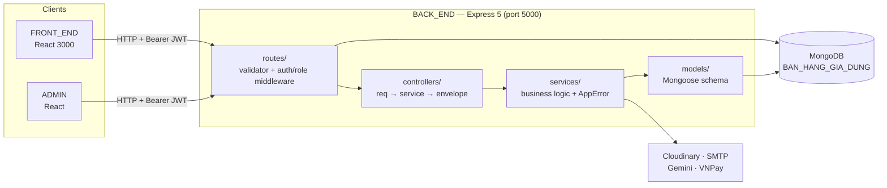
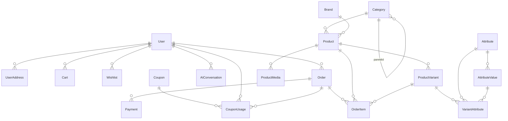
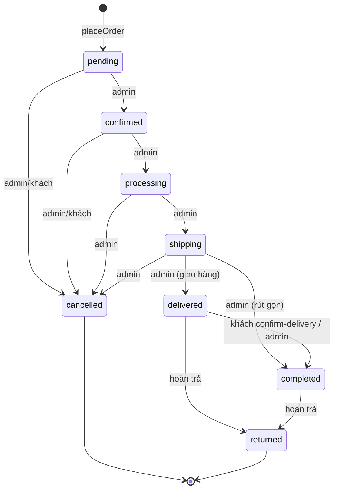
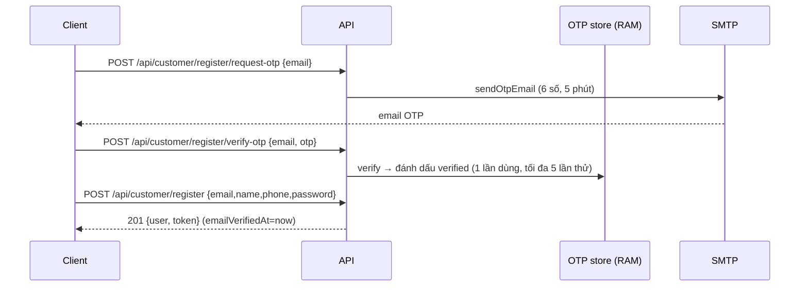
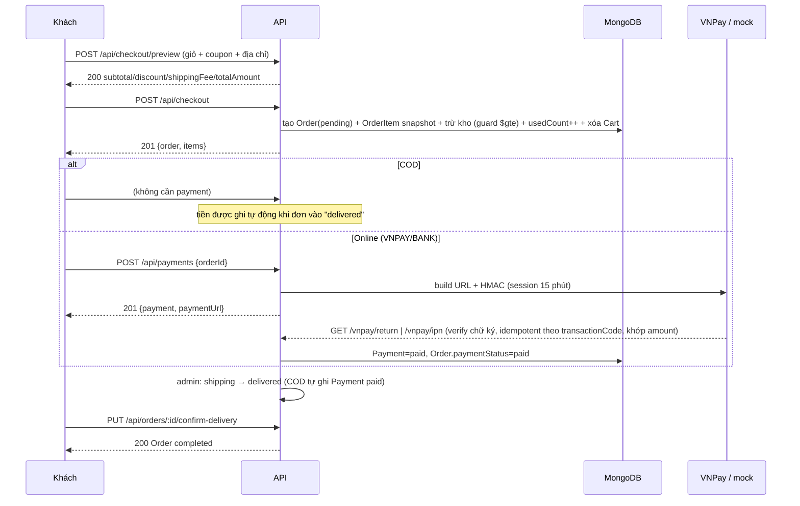
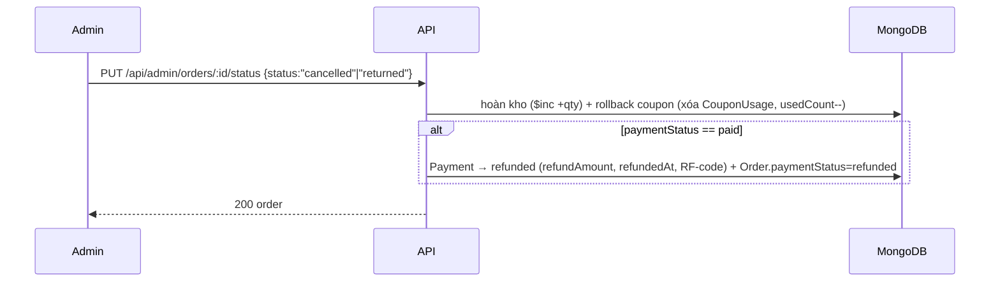
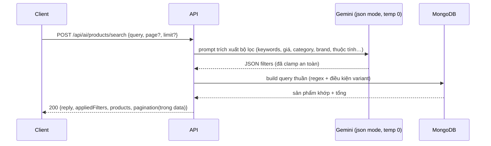

# TÀI LIỆU API BACKEND — BÀN GIAO & VERIFY

| | |
|---|---|
| **Phiên bản** | 1.0 — 2026-10-29 |
| **Áp dụng cho** | `BACK_END` @ branch `do/feat` (HEAD `943cd38`), 119 endpoint |
| **Trạng thái** | ✅ ĐÓNG BĂNG (frozen) — mọi thay đổi sau đây phải bump phiên bản và cập nhật mục Verify |
| **Đối tượng** | Developer tích hợp (FRONT_END / ADMIN / bên thứ 3) + QA verify |
| **Nguồn chân lý** | Tài liệu này + [AUDIT/API_CATALOG.md](../AUDIT/API_CATALOG.md) (inventory) + [AUDIT/E2E_EVIDENCE_2026-10-24.md](../AUDIT/E2E_EVIDENCE_2026-10-24.md) (bằng chứng 242/242 PASS) |

> **Cách đọc nhãn Verify:** `E2E:<suite>` = đã chạy qua bởi test integration (log ở `AUDIT/e2e-logs/`) · `V` = verified bằng đọc code + kiểm tra in-process · `V*` = verified code, chưa có E2E (xem §6.3).

---

## MỤC LỤC

1. [Quy ước chung](#1-quy-ước-chung)
2. [Sơ đồ luồng](#2-sơ-đồ-luồng)
3. [Schema dùng chung](#3-schema-dùng-chung)
4. [Tham chiếu endpoint](#4-tham-chiếu-endpoint)
5. [Ma trận verify](#5-ma-trận-verify)
6. [Giới hạn đã biết & phụ lục](#6-giới-hạn-đã-biết--phụ-lục)

---

# 1. QUY ƯỚC CHUNG

## 1.1 Base URL & môi trường

| Môi trường | URL | Ghi chú |
|---|---|---|
| Dev | `http://localhost:5000` | `npm run dev` (tsx, không cần build) |
| Health check | `GET /` | → `{"success":true,"message":"Backend API đang hoạt động"}` |

- Content-Type: `application/json` (trừ 2 endpoint upload avatar dùng `multipart/form-data`).
- Không versioning trong URL (v1 ngầm định).

## 1.2 Authentication

- **Bearer JWT** trong header: `Authorization: Bearer <token>`.
- Payload token: `{ userId, role }` với `role ∈ {customer, admin}`; hạn mặc định **7 ngày** (`JWT_EXPIRES_IN`).
- Token lấy từ `POST /api/customer/login` hoặc `POST /api/admin/login` (kèm trong `data.token`).
- Thiếu/sai token → **401**; đúng token sai vai trò → **403**.
- Mọi API admin nằm dưới prefix **`/api/admin/*`** (đồng nhất từ 2026-10-22).

## 1.3 Response envelope — MỘT quy tắc

**Thành công:**
```json
{ "success": true, "message": "…", "data": … }
```
- `data`: object (chi tiết) hoặc **mảng** (danh sách). Danh sách phân trang kèm `pagination` top-level (§1.5).

**Lỗi — tất cả qua một middleware duy nhất** (`src/middlewares/error.middleware.ts`):
```json
{ "success": false, "message": "Mã giảm giá không tồn tại." }
```
Lỗi validation (400 từ express-validator) kèm thêm mảng lỗi theo field — **ví dụ thật từ server**:
```json
{ "success": false, "message": "Dữ liệu không hợp lệ",
  "errors": [ { "field": "name", "message": "Tên thương hiệu không được để trống" } ] }
```

## 1.4 Bảng mã lỗi (quy ước toàn hệ thống)

| Mã | Khi nào | Ví dụ message |
|---|---|---|
| 200 / 201 | Thành công / tạo mới | — |
| 400 | Dữ liệu sai, vi phạm nghiệp vụ (hết hạn, vượt tồn kho, trùng mã, chuyển trạng thái sai) | `"Số lượng yêu cầu (5) vượt quá tồn kho khả dụng (3)."` |
| 401 | Chưa đăng nhập / token hết hạn | `"Bạn chưa đăng nhập"` |
| 403 | Sai vai trò | `"Bạn không có quyền thực hiện chức năng này"` |
| 404 | Không tồn tại **hoặc không thuộc quyền sở hữu** (không tiết lộ sự tồn tại) | `"Đơn hàng không tồn tại hoặc không thuộc về bạn."` |
| 429 | Gửi OTP quá nhanh (cooldown 60s) | kèm `retryAfter` (giây) |
| 500 | Lỗi hệ thống — message gốc **bị che**, chỉ có message chung | `"Đã xảy ra lỗi máy chủ. Vui lòng thử lại sau."` |

Lỗi Mongoose được middleware tự map về 400: thiếu trường/sai enum (ValidationError), ID sai định dạng (CastError → `"ID không đúng định dạng."`), trùng unique (E11000 → `"Giá trị của trường 'code' đã tồn tại."`).

## 1.5 Pagination (offset, chuẩn hóa 2026-10-24)

**Request:** `?page=<int≥1>&limit=<int>` · **Response:** `data` = mảng + `pagination` top-level:

```json
{ "success": true, "message": "…",
  "data": [ … ],
  "pagination": { "page": 1, "limit": 2, "total": 0, "totalPages": 0 } }
```
*(response thật từ `GET /api/brands?page=1&limit=2`)*

- Hai endpoint tổng hợp kèm **`summary` top-level**: `GET /api/admin/payments`, `GET /api/admin/order-items`.
- Default limit: catalog public 20 (categories 50), khối commerce/admin 10, `featured` 8, `related` 4. Cap: 100 (orders/payments/coupons/customers), 50 (featured), 20 (AI search).
- **Không phân trang** (`data` mảng, không có `pagination`): `my-payments`, `cart`, `wishlist`, `coupons/public`, `user-addresses`, `attributes`, `categories/tree`, order-items theo đơn.
- Ngoại lệ duy nhất: `POST /api/ai/products/search` trả pagination **bên trong** `data` với field riêng (`totalProducts`, `hasMore`) — xem §4.16.

## 1.6 Quy ước REST đã áp dụng

- Resource số nhiều: `/api/brands`, `/api/orders`…; quan hệ lồng: `/api/products/:productId/variants`.
- Admin luôn prefix `/api/admin/<resource>` — public/admin **không** trộn path.
- Method ngữ nghĩa: `POST` tạo · `PUT /:id` sửa toàn phần · `PATCH /:id/status|featured|stock` đổi trường đơn · `DELETE /:id` xóa.
- Slug lookup public: `GET /<resource>/slug/:slug` · Danh sách admin toàn bộ: `GET /api/admin/<resource>/all`.
- Định danh: Mongo ObjectId (24 hex). Response luôn trả **`id`** (bản sao `_id`), không trả `_id`, không trả `__v`, không trả `password`.
- Timestamps: `createdAt`/`updatedAt` ISO-8601 (UTC).

---

# 2. SƠ ĐỒ LUỒNG

## 2.1 Kiến trúc & phân lớp



## 2.2 ERD rút gọn (25 collection — 7 model chưa dùng đã lược khỏi sơ đồ)



## 2.3 State machine đơn hàng (nguồn: `ORDER_STATUS_TRANSITIONS`)



**Nguyên tắc tiền theo trạng thái:** COD ghi tiền ngay tại `delivered` (idempotent) · `cancelled` đơn đã paid → **tự refund** · `returned` đã paid → **tự refund** (ghi cả Payment) · khách chỉ được tự hủy khi `pending/confirmed` và chưa paid.

## 2.4 Sequence — Đăng ký khách hàng (OTP email)


Cooldown gửi lại 60s (429 + `retryAfter`). Quên mật khẩu dùng luồng tương tự với `forgot-password` → `reset-password`.

## 2.5 Sequence — Checkout → Thanh toán → Hoàn tất



## 2.6 Sequence — Hoàn tiền tự động (hủy đơn paid / hoàn trả)


Refund thủ công riêng: `POST /api/admin/payments/:id/refund` (cho phép refund một phần). Lưu ý: refund hiện **chỉ ghi sổ DB**, chưa gọi API gateway.

## 2.7 Sequence — AI tìm kiếm sản phẩm (Gemini)


Retry khi Gemini 503/429 (2 lần). AI chat tư vấn: luồng tương tự nhưng kèm hội thoại (AIConversation, tối đa 8 sản phẩm ngữ cảnh, 12 tin nhắn lịch sử).

---

# 3. SCHEMA DÙNG CHUNG

> response thật (đã lấy từ server 2026-10-29); các trường nullable có thể vắng → null.

**User (public — không bao giờ trả password)**: `id, name, email, phone, avatar, role("customer"|"admin"), status("active"|"inactive"|"blocked"), emailVerifiedAt, createdAt, updatedAt`

**Category**: `id, parentId, name, slug, description, image, metaTitle, metaDescription, sortOrder, isActive, createdAt, updatedAt` — cây: `children[]` (endpoint `/tree`, `/:id`).

**Brand**: `id, name, slug, description, logo, isActive, createdAt, updatedAt`

**Attribute**: `id, name, slug, values?: [{id, value, slug}]`

**Product (list)**: `id, categoryId, brandId, name, slug, sku, description, basePrice, salePrice, minPrice, maxPrice, averageRating, totalReviews, totalSales, isFeatured, isActive, createdAt, updatedAt, thumbnail?`

**Product (detail — thêm)**: `media[]` (isPrimary trước), `variants[]` (active, mỗi variant kèm `attributes: [{attributeId, name, value}]`), `category`, `brand` populate.

**ProductVariant**: `id, productId, sku, price, compareAtPrice, stockQuantity, weight, image, isActive`

**ProductMedia**: `id, productId, mediaType("image"|"video"), mediaUrl, altText, sortOrder, isPrimary`

**CartItem** (từ `GET /api/cart`): `items: [{id, product, variant, quantity, unitPrice, originalPrice, availableStock, isAvailable}]`, `subtotal`, `totalQuantity` — subtotal **chỉ tính item còn hàng**.

**WishlistItem**: `id, product, createdAt`

**Coupon**: `id, code, name, description, discountType("percentage"|"fixed"), discountValue, minimumOrderAmount, maximumDiscountAmount, usageLimit, usedCount, perUserLimit, startsAt, expiresAt, isActive, createdAt, updatedAt`

**UserAddress**: `id, recipientName, phone, addressLine, ward, district, province, isDefault`

**Order**: `id, orderNumber("DH-YYYYMMDD-NNNNNN"), userId, couponId, customerName/Email/Phone, shippingAddress/Ward/District/Province, subtotal, discountAmount, shippingFee, taxAmount, totalAmount, paymentMethod, paymentStatus, status, note, confirmedAt, shippedAt, deliveredAt, completedAt, cancelledAt, createdAt, updatedAt`

**OrderItem** (snapshot): `id, orderId, productId, variantId, productName, productSku, variantSku, variantAttributes, quantity, unitPrice, discountAmount, totalPrice`

**Payment**: `id, orderId, paymentMethod, transactionCode, gatewayOrderId, amount, currency("VND"), orderInfo, paymentUrl, expiredAt, status("pending"|"paid"|"failed"|"refunded"), gatewayResponse, failedReason, refundAmount, refundedAt, refundTransactionCode, paidAt, createdAt, updatedAt`

---

# 4. THAM CHIẾU ENDPOINT (119)

> Định dạng: `METHOD path` — Auth · Request · Response · Lỗi đặc thù · Verify.
> `Auth: User` = JWT customer; `Admin` = JWT admin; `Public` = không cần.

## 4.1 Health
- `GET /` — Public → `200 {success, message}` · V

## 4.2 Customer Auth — `/api/customer`
| | |
|---|---|
| `POST /register/request-otp` | Public · body `{email}` · 200 · 400 email trùng/Invalid · 429 cooldown (kèm `retryAfter`) · V* |
| `POST /register/verify-otp` | Public · `{email, otp}` · 200 · 400 sai/hết hạn · V* |
| `POST /register` | Public · `{email, name, phone?, password}` (password ≥6) · **201 `{user, token}`** · 400 chưa verify OTP/email trùng · V* |
| `POST /login` | Public · `{email, password}` · 200 `{user, token}` · 401 sai/blocked · V* |
| `POST /forgot-password` | Public · `{email}` · 200 (không tiết lộ email tồn tại) · V* |
| `POST /reset-password` | Public · `{email, otp, newPassword}` · 200 · 400 OTP sai/pass trùng cũ · V* |
| `GET /me` | User · 200 `{user}` · V* |
| `POST /change-password` | User · `{currentPassword, newPassword}` · 200 · 400 sai pass hiện tại · V* |
| `PATCH /profile` | User · `multipart/form-data`: `name?, phone?, avatar?(file ≤5MB jpeg/png/webp/gif → Cloudinary)` · 200 `{user}` · V* |
| `POST /logout` | User · 200 (stateless — client tự bỏ token) · V* |

## 4.3 Admin Auth — `/api/admin`
`POST /login` · `POST /forgot-password` · `POST /reset-password` · `POST /change-password` · `GET /me` · `PATCH /profile` (avatar) · `POST /logout` — như 4.2 nhưng role admin, đăng nhập bị chặn nếu status ≠ active.
Đặc thù riêng:
| | |
|---|---|
| `POST /change-email/request-otp` | Admin · `{newEmail}` — OTP gửi tới email MỚI, bind userId · 200/400 · V* |
| `POST /change-email/verify` | Admin · `{newEmail, otp}` — đổi email + `emailVerifiedAt` · 200 `{user}` · V* |

## 4.4 Admin quản lý khách hàng — `/api/admin/customers` (Admin)
| | |
|---|---|
| `GET /` | query: `keyword, status(active/inactive/blocked), page, limit(≤100), sortBy(createdAt/name/email), sortOrder` · 200 `data[] + pagination` · V* |
| `GET /:id` | 200 `{customer}` · 404 · V* |
| `PATCH /:id/status` | `{status}` · 200 · 400 giá trị ngoài whitelist · V* |

## 4.5 Statistics
| | |
|---|---|
| `GET /api/customer/statistics/overview` | User(customer) · `{totalOrders, ordersByStatus, totalSpent (đơn delivered+completed), totalReviews, totalWishlistItems}` · V* |
| `GET /api/customer/statistics/orders` · `/reviews` | User(customer) · V* |
| `GET /api/admin/statistics/users` | Admin · `{customers{total,active,inactive,blocked}, totalAdmins, newCustomersThisMonth, period}` · V* |

## 4.6 Brand — public `/api/brands` + admin `/api/admin/brands`
Public: `GET /?page&limit&search&sortBy&sortOrder` (default limit 20) · `GET /slug/:slug` · `GET /:id` — chỉ hiện `isActive=true` · E2E:test-category…**brand suite trong test-product** (26 case mục VI).
Admin: `GET /all?page&limit&search&isActive` · `POST / {name, description?, logo?, slug?, isActive?}` (slug tự sinh bỏ dấu) · `GET|PUT /:id` · `PATCH /:id/status {isActive?}` (trống = đảo) · `DELETE /:id` — **400 nếu còn Product** · E2E:brand (trong EVIDENCE mục VI).

**Response tạo thật:**
```json
{ "success": true, "message": "Tạo thương hiệu thành công.", "data": { "id": "6ae…dbd6", "name": "Sunhouse Test", "slug": "sunhouse-test", "isActive": true, … } }
```

## 4.7 Category — `/api/categories` + `/api/admin/categories`
Public: `GET /` (default limit **50**, `parentId="null"` = lấy gốc, sort `sortOrder`) · `GET /tree` (không phân trang) · `GET /slug/:slug` · `GET /:id` (kèm subCategories active).
Admin: `GET /all` · `POST / {name, parentId?, description?, image?, metaTitle?, metaDescription?, sortOrder?, isActive?}` · `PUT /sort-order {items:[{id,sortOrder}]}` (bulk) · `GET|PUT /:id` (**400 nếu tạo vòng lặp cha–con**) · `PATCH /:id/status` · `DELETE /:id` — **400 nếu còn danh mục con hoặc Product** · E2E:test-category (22).

## 4.8 Attribute — `/api/attributes` + `/api/admin/attributes`
Public: `GET /` (kèm values) · `GET /:id`.
Admin: `POST / {name, slug?}` · `PUT /:id` · `DELETE /:id` (chặn nếu VariantAttribute dùng; cascade values) · `POST /:id/values {value}` · `PUT|DELETE /values/:valueId` · E2E:test-attribute (18).

## 4.9 Product — `/api/products` + `/api/admin/products`
Public: `GET /?page&limit&categoryId&brandId&minPrice&maxPrice&isFeatured&search&sort(newest/price_asc/price_desc/sales/rating)` (default 20; filter giá theo `basePrice`) · `GET /featured?limit≤50` (default 8) · `GET /related/:id?limit` (default 4, cùng category/brand) · `GET /slug/:slug` · `GET /:id` (detail §3).
Admin: `GET /all` (kèm `stats {totalProducts, activeProducts, inactiveProducts, featuredProducts}`) · `POST / {name, sku, categoryId, brandId?, basePrice, salePrice?, description?, metaTitle?, metaDescription?, isActive?, isFeatured?}` — **400 nếu salePrice > basePrice**, sku/slug tự unique · `GET|PUT /:id` · `PATCH /:id/status` · `PATCH /:id/featured` · `DELETE /:id` — **400 nếu đã có OrderItem** (cascade variant/media) · E2E:test-product (32) + session3 (11).

## 4.10 Product Variant — `/api/products/:productId/variants` (public) + `/api/admin/...`
Public: `GET /products/:productId/variants` (active + attributes) · `GET /variants/:id`.
Admin: `GET|POST /admin/products/:productId/variants` — body tạo `{sku, price, stockQuantity?, compareAtPrice?, weight?, image?, isActive?, attributes:[{attributeId, attributeValueId}]}` (mỗi attribute 1 lần/variant) · `PUT /admin/variants/:id` (thay attributes = delete+insert) · `PATCH /admin/variants/:id/stock {stockQuantity}` (ghi đè trực tiếp) · `PATCH /admin/variants/:id/status` · `DELETE /admin/variants/:id` (chặn nếu có OrderItem).
**Invariant:** mọi thay đổi variant → tự động đồng bộ `Product.minPrice/maxPrice` · E2E:test-product-variant (22).

## 4.11 Product Media — `/api/products/:productId/media` (public) + `/api/admin/...`
Media nhận **URL từ JSON** (không upload file ở đây). Public: `GET /products/:productId/media` (sort: primary → sortOrder).
Admin: `GET /admin/products/:productId/media` · `POST .../media {mediaType, mediaUrl, altText?, isPrimary?, sortOrder?}` · `POST .../media/batch {mediaList[]}` · `PUT /admin/media/:id` · `PATCH /admin/media/:id/primary` (**400 nếu mediaType=video**) · `PUT .../media/sort-order {sortOrders[]}` · `DELETE /admin/media/:id` · `DELETE .../media {mediaIds[]}`.
**Invariant:** ảnh đầu tiên tự làm primary; xóa primary → tự thăng cấp ảnh sớm nhất · E2E:test-product-media (19).

## 4.12 Cart — `/api/cart` (User)
| | |
|---|---|
| `GET /` | 200 `data.items[] + subtotal + totalQuantity` (§3) · E2E:test-cart (14) |
| `POST /` | `{productId, variantId?, quantity?}` (default 1) · **201** · 404 sản phẩm/biến thể · 400 vượt tồn kho · cùng (product, variant) → **cộng dồn quantity** · sản phẩm không biến thể: kho giả định 9999 · E2E:test-cart |
| `PUT /:id` | `{quantity}` · 200 · 400 vượt kho · 404 không phải của mình · E2E:test-cart |
| `DELETE /:id` · `DELETE /` | 200 · E2E:test-cart |

## 4.13 Wishlist — `/api/wishlist` (User)
`GET /` · `POST / {productId}` (201, idempotent; 404 nếu sản phẩm inactive) · `GET /check/:productId → {isInWishlist, wishlistId}` · `POST /:id/move-to-cart {variantId?, quantity?}` (201 cart item — nếu hết hàng **giữ lại** wishlist) · `DELETE /product/:productId` · `DELETE /:id` · `DELETE /` · E2E:test-wishlist (11) + session4.

## 4.14 Coupon — `/api/coupons` (public/user) + `/api/admin/coupons`
| | |
|---|---|
| `GET /public` | Public · coupon đang hiệu lực (còn lượt) · E2E:test-coupon (26) |
| `POST /check` | User · `{code, orderAmount}` → `{valid, coupon, discountAmount, finalAmount}` · Thứ tự chặn: 404 không tồn tại → 400 khóa/chưa đến hạn/hết hạn/hết lượt/hết lượt cá nhân/chưa đạt tối thiểu · `percentage` capped `maximumDiscountAmount` · E2E:test-coupon |
| `GET /admin` | Admin · `search, isActive, page, limit` · E2E:test-coupon |
| `POST /admin` | `{code, name, discountType, discountValue, minimumOrderAmount?, maximumDiscountAmount?, usageLimit?, perUserLimit?, startsAt?, expiresAt?, description?}` · 400 trùng code · E2E |
| `GET /admin/:id` | kèm `totalDiscountAmountGiven` · 404 |
| `PUT /admin/:id` · `PATCH /admin/:id/status` (đảo isActive) | 200 |
| `DELETE /admin/:id` | **400 nếu đã có lượt dùng** ("hãy chuyển sang Không hoạt động") |
| `GET /admin/:id/usages` | 200 `data[] + pagination` (user + order populate) |

## 4.15 User Address — `/api/user-addresses` (User)
`GET /` (default trước) · `POST /` (201; **địa chỉ đầu tự làm default**) `{recipientName, phone, addressLine, ward?, district?, province?, isDefault?}` · `GET /:id` · `PATCH /:id` · `PATCH /:id/default` (chuyển default, bỏ default cũ) · `DELETE /:id` (nếu xóa default → địa chỉ mới nhất lên thay) · V* (chưa có E2E).

## 4.16 AI — `/api/ai` (Public — hỗ trợ khách vãng lai qua `sessionId`)
| | |
|---|---|
| `POST /products/search` | `{query, page?, limit?}` (default limit 5, cap 20) → `{reply, appliedFilters, products[], pagination{page,limit,totalProducts,totalPages,hasMore}}` — **pagination nằm trong data** (ngoại lệ) · 400 query trống · 500 nếu Gemini lỗi (sau 2 lần retry 503/429) · V* (cần GEMINI_API_KEY) |
| `POST /chat` | `{message, conversationId?, sessionId?}` → `{conversationId, title, answer, products[], createdAt}` · V* |
| `POST /chat/conversations` · `GET /chat/conversations` (≤50) · `GET /chat/conversations/:id` · `DELETE /chat/conversations/:id` | quản lý hội thoại theo `userId` hoặc `sessionId` · V* |

## 4.17 Checkout — `/api/checkout` (User)
| | |
|---|---|
| `POST /preview` | body `{addressId? | customerName+customerPhone+shippingAddress(+Ward/District/Province)?, selectedCartItemIds?, couponCode?, shippingFee?, paymentMethod?, note?}` → 200 tổng kết (subtotal, discountAmount, shippingFee, totalAmount, items) · 404 địa chỉ sai · 400 thiếu thông tin/giỏ trống/coupon không hợp lệ · E2E:test-checkout (11) |
| `POST /` | như preview → **201 `{order, items}`** · quy trình: snapshot OrderItem → trừ kho **atomic có guard** (400 nếu không đủ giữa chừng) → `usedCount++` + CouponUsage → xóa Cart items đã mua · `orderNumber: DH-YYYYMMDD-NNNNNN` · E2E:test-checkout + session4 |

## 4.18 Order — `/api/orders` (User)
| | |
|---|---|
| `GET /my-orders` | `?status&page&limit` · 200 `data[] + pagination` · E2E:test-order (20) |
| `GET /:id` | ownership (404 nếu không phải của mình) · 200 order · E2E |
| `PUT /:id/cancel` | chỉ `pending/confirmed` **và** chưa paid · 200 · 400 đã vào quy trình/đã paid · hoàn kho + rollback coupon · E2E |
| `PUT /:id/confirm-delivery` | chỉ `delivered` → `completed` (+completedAt) · 200 · 400 trạng thái khác · 404 không phải của mình · E2E:test-order |
| `GET /:id/items` | (mount `/api/orders`) owner hoặc admin · 200 `data[]` · E2E:test-order-item |

## 4.19 Admin Order — `/api/admin/orders` (Admin)
`GET /?search&status&paymentStatus&paymentMethod&userId&from&to&page&limit` (search theo orderNumber/tên/email) · `GET /:id` (kèm `itemCount`) · `PUT /:id/status {status}` — validate state machine (400 chuyển sai), tự set mốc `confirmedAt/shippedAt/deliveredAt/completedAt/cancelledAt`, **COD tự ghi payment tại delivered**, hủy đơn paid tự refund, `returned` hoàn kho + coupon + refund · E2E:test-order (20).

## 4.20 Admin Order Item — `/api/admin/order-items` (Admin)
`GET /?orderId&productId&variantId&from&to&page&limit` → `data[] + pagination + summary{totalQuantity, totalRevenue}` · E2E:test-order-item (10).

## 4.21 Payment — `/api/payments`
| | |
|---|---|
| `POST /` | User · `{orderId}` → **201 `{payment, paymentUrl, bankTransferInfo?}`** · 400 đơn không ở trạng thái thanh toán được/đã paid · tái sử dụng session còn hạn (15 phút), session hết hạn → đánh failed + tạo mới · E2E:test-payment (14) |
| `GET /my-payments` | User · không phân trang, kèm `order {orderNumber, status}` · E2E |
| `GET /vnpay/return` | Public (gateway) · verify HMAC → **302 redirect** `${CLIENT_URL}/payment/result?order&status` · E2E (mock) |
| `GET /vnpay/ipn` · `POST /momo/ipn` · `POST /zalopay/callback` | Public (gateway) · luôn **200** theo protocol từng cổng: VNPay `{RspCode, Message}` (00/02/97/99) · MoMo `{resultCode, message}` (0/42/99) · ZaloPay `{return_code, return_message}` (0/1) · idempotent theo `transactionCode`, sai số tiền → 400 · E2E (mock VNPay) |
| `POST /mock/complete` | **chỉ tồn tại khi `PAYMENT_ENV=mock``** (khác → 404) · `{orderNumber, success?, amount?}` → 200 · E2E:test-payment |

## 4.22 Admin Payment — `/api/admin/payments` (Admin)
`GET /?paymentMethod&status&orderId&from&to&page&limit` → `data[] + pagination + summary{totalPaidAmount, totalPaidCount, totalRefundedAmount}` · `POST /:id/refund {amount?, reason?}` — chỉ Payment `paid`; một phần nếu `amount < payment.amount`; ghi Payment+Order refunded · E2E:test-payment.

---

# 5. MA TRẬN VERIFY

## 5.1 Độ phủ E2E (nguồn: [E2E_EVIDENCE_2026-10-24.md](../AUDIT/E2E_EVIDENCE_2026-10-24.md) — 242/242 PASS)

| Suite | Case | Phạm vi chính |
|---|---|---|
| test-category | 22 | CRUD category, tree, vòng lặp, guards |
| test-attribute | 18 | Attribute + values, guards |
| test-product | 32 | CRUD sản phẩm, filter, giá, cascade |
| test-product-variant | 22 | Biến thể, sync min/max, kho |
| test-product-media | 19 | Media, primary, batch |
| test-session3 | 11 | Tích hợp catalog |
| test-cart | 14 | Kho, merge, cross-user (404) |
| test-wishlist | 11 | Idempotent, move-to-cart |
| test-coupon | 26 | 7 luật validate + admin + usages |
| test-session4 | 12 | Tích hợp commerce + cross-user |
| test-checkout | 11 | Preview/place, trừ kho guard, coupon |
| test-order | 20 | State machine (gồm delivered/confirm-delivery), refund tự động (Order+Payment), COD tại delivered |
| test-order-item | 10 | Snapshot, filter, summary |
| test-payment | 14 | Session, HMAC, idempotent, mock, refund |

## 5.2 Quy trình verify khi nhận bản delivery mới

1. `npx tsc --noEmit` → 0 lỗi.
2. Môi trường: `docker run -d --name giadung-mongo -p 27017:27017 mongo:7` → `PAYMENT_ENV=mock npm run dev` → `npm test` → **14 suite, 242 PASS, exit 0** (log mẫu: `AUDIT/e2e-logs/2026-10-24-npm-test-full.log`).
3. Đối chiếu thay đổi với tài liệu này: endpoint đổi contract → bump version tài liệu.

## 5.3 Endpoint CHƯA có E2E (verified bằng đọc code + in-process — đã đánh dấu V* ở §4)

Nhóm auth (10 customer + 9 admin), user-addresses (6), admin customers (3), statistics (4), AI (6). **Khuyến nghị bổ sung test script cho các nhóm này trước khi đưa môi trường production.**

---

# 6. GIỚI HẠN ĐÃ BIẾT & PHỤ LỤC

## 6.1 Giới hạn nghiệp vụ đã chốt (đừng ghi là bug)
1. **MoMo/ZaloPay chưa kích hoạt** — chỉ có verify callback; không tạo được URL thanh toán (chờ cấu hình gateway). VNPay + `PAYMENT_ENV=mock` hoạt động đầy đủ.
2. **`shippingFee` do client gửi** từ checkout (đã chốt 2026-10-24); backend chưa có bảng phí — tính năng admin cấu hình phí làm sau. `taxAmount` luôn 0.
3. Refund **chỉ ghi sổ DB**, chưa gọi API hoàn tiền gateway.
4. AI endpoint công khai, không rate-limit; cần `GEMINI_API_KEY`.
5. OTP lưu trong RAM server (restart mất OTP đang chờ) — giới hạn đã biết của module auth.
6. 7 model chưa dùng (OtpCode, Announcement×3, Notification, Conversation, Message) tồn tại trong DB nhưng không có API.

## 6.2 Biến môi trường
Bắt buộc: `PORT`, `MONGO_URI`, `JWT_SECRET`, `PAYMENT_ENV(sandbox|production|mock)`, `CLIENT_URL`.
Theo tính năng: `VNP_*` (VNPay), `MOMO_*`/`ZALOPAY_*` (chưa dùng), `BANK_*`, `MAIL_*` (OTP), `CLOUDINARY_*` (avatar), `GEMINI_*` (AI), `ADMIN_*` (script create-admin). Xem `.env.example`.

## 6.3 Nguồn quy tắc tài liệu đã tham khảo
- [OpenAPI 3.1 — The Cheat Sheet](https://dev.to/bump/openapi-31-the-cheat-sheet-c9l) · [Fern: API Documentation Best Practices](https://buildwithfern.com/post/api-documentation-best-practices-guide) · [Speakeasy: Documentation](https://www.speakeasy.com/api-design/documentation)
- Pagination envelope: [Knit: API Pagination Best Practices](https://getknit.dev/blog/api-pagination-best-practices) · [Speakeasy: Pagination](https://www.speakeasy.com/api-design/pagination) · [apisyouwonthate](https://apisyouwonthate.com/blog/api-design-basics-pagination)
- REST & error conventions: [Moesif: 12 REST Best Practices 2026](https://www.moesif.com/blog/technical/api-development/essential-REST-API-best-practices) · [Postman: REST Best Practices](https://blog.postman.com/rest-api-best-practices) · [OAI discussion #398 — API-wide error responses](https://github.com/OAI/OpenAPI-Specification/issues/398)
- Sơ đồ: Mermaid (stateDiagram/sequenceDiagram/erDiagram) render trực tiếp trên GitHub.

*Bước tiến hóa đề xuất (ngoài phạm vi bản này): sinh `openapi.yaml` từ tài liệu này để có Swagger UI + contract test tự động.*
