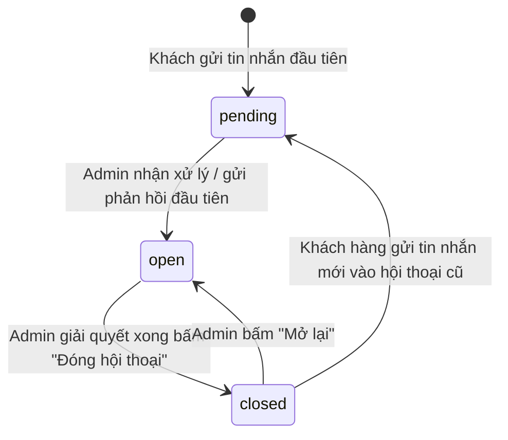
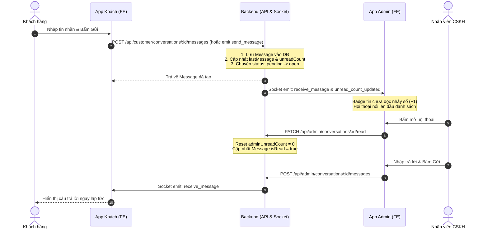
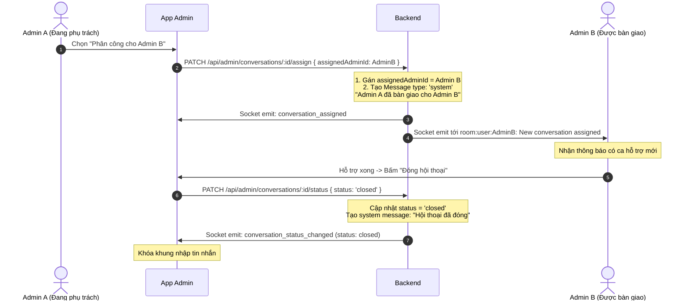

# BÁO CÁO RÀ SOÁT LOGIC BACKEND: PHÂN HỆ HỘI THOẠI KHÁCH HÀNG (CSKH)

> **Dự án:** Phân tích & Thiết kế Website Bán Hàng Gia Dụng  
> **Phân hệ:** Quản lý giao tiếp khách hàng — Chăm sóc khách hàng & Hội thoại hỗ trợ (Customer Support Conversations)  
> **Ngày lập báo cáo:** 14/11/2026  
> **Người thực hiện:** Antigravity (AI Assistant)  
> **Trạng thái:** Hoàn thành rà soát hiện trạng & Đề xuất giải pháp kiến trúc chi tiết  

---

## MỤC LỤC
1. [Tóm tắt kết luận (Executive Summary)](#1-tóm-tắt-kết-luận-executive-summary)
2. [Chi tiết rà soát hiện trạng hệ thống](#2-chi-tiết-rà-soát-hiện-trạng-hệ-thống)
   - [2.1. Phía Backend (`BACK_END`)](#21-phía-backend-back_end)
   - [2.2. Phía Giao diện Quản trị (`ADMIN`)](#22-phía-giao-diện-quản-trị-admin)
   - [2.3. Phía Giao diện Người dùng (`FRONT_END`)](#23-phía-giao-diện-người-dùng-front_end)
3. [Phân tích khoảng trống kỹ thuật (Gap Analysis)](#3-phân-tích-khoảng-trống-kỹ-thuật-gap-analysis)
4. [Đề xuất kiến trúc & Thiết kế logic cần bổ sung](#4-đề-xuất-kiến-trúc--thiết-kế-logic-cần-bổ-sung)
   - [4.1. Hạ tầng Real-time (Socket.io Architecture)](#41-hạ-tầng-real-time-socketio-architecture)
   - [4.2. Danh tả đặc tả REST API (Admin & Customer)](#42-danh-tả-đặc-tả-rest-api-admin--customer)
   - [4.3. Logic nghiệp vụ & Vòng đời hội thoại (State Machine)](#43-logic-nghiệp-vụ--vòng-đời-hội-thoại-state-machine)
   - [4.4. Quy trình Bàn giao nhân viên (Assign/Transfer)](#44-quy-trình-bàn-giao-nhân-viên-assigntransfer)
   - [4.5. Cơ chế Đếm tin chưa đọc (Unread Count & Read Receipts)](#45-cơ-chế-đếm-tin-chưa-đọc-unread-count--read-receipts)
5. [Sơ đồ quy trình hoạt động (Sequence Diagrams)](#5-sơ-đồ-quy-trình-hoạt-động-sequence-diagrams)
6. [Kế hoạch & Lộ trình triển khai khuyến nghị](#6-kế-hoạch--lộ-trình-triển-khai-khuyến-nghị)

---

## 1. TÓM TẮT KẾT LUẬN (EXECUTIVE SUMMARY)

Qua quá trình rà soát toàn bộ source code của 3 phân hệ `BACK_END`, `ADMIN` và `FRONT_END`:

| Thành phần | Trạng thái | Đánh giá & Phát hiện chính |
| :--- | :---: | :--- |
| **Database Schema** | 🟡 **70%** | Đã có sẵn 2 Mongoose Model: `Conversation.model.ts` và `Message.model.ts` với cấu trúc khá chuẩn. Cần bổ sung thêm một số trường audit/tracking. |
| **Logic Backend** | 🔴 **0%** | **Hoàn toàn chưa có code xử lý logic.** Chưa có Controller, Service, Route, Validator nào cho hội thoại CSKH người thật (mới chỉ có AI Chatbot Gemini). |
| **Hạ tầng Real-time** | 🔴 **0%** | Chưa cài đặt thư viện WebSocket (`socket.io`), server Express chỉ đang chạy HTTP thuần thông qua `app.listen()`. |
| **Frontend Admin** | 🟡 **80% UI** | Đã dựng hoàn thiện giao diện chat, lọc trạng thái, phân công nhân viên, đóng/mở hội thoại nhưng **100% đang chạy bằng Mock Data** trong RAM. |
| **Frontend Client** | 🔴 **0%** | Phía khách hàng chưa có widget chat hay giao diện gửi tin nhắn CSKH tới Admin. |

> ⚠️ **Xác nhận nợ kỹ thuật:** Trong tài liệu chính thức của dự án tại `BACK_END/API_DOCS/BACKEND_API_DOCUMENTATION.md` (dòng 477), hệ thống cũng đã ghi nhận:  
> *"7 model chưa dùng (OtpCode, Announcement×3, Notification, Conversation, Message) tồn tại trong DB nhưng không có API."*

---

## 2. CHI TIẾT RÀ SOÁT HIỆN TRẠNG HỆ THỐNG

### 2.1. Phía Backend (`BACK_END`)

#### A. Những gì đã có:
1. **Model `Conversation` (`BACK_END/src/models/Conversation.model.ts`):**
   - Trường liên kết: `customerId` (ref: `User`), `assignedAdminId` (ref: `User`, null nếu chưa tiếp nhận).
   - Trạng thái: `status` với 3 giá trị Enum: `'open'` (Đang xử lý), `'pending'` (Chờ tiếp nhận), `'closed'` (Đã đóng).
   - Trường hiệu năng: `lastMessageAt`, `lastMessagePreview` (denormalized để load danh sách không cần JOIN).
   - Trường đếm: `customerUnreadCount`, `adminUnreadCount` (number).
   - Đã cấu hình các index phục vụ query theo `customerId`, `assignedAdminId`, `status`, `lastMessageAt`.
2. **Model `Message` (`BACK_END/src/models/Message.model.ts`):**
   - Trường liên kết: `conversationId` (ref: `Conversation`), `senderId` (ref: `User`).
   - Phân loại: `messageType` với Enum: `'text'`, `'image'`, `'file'`, `'system'`.
   - Nội dung: `content`, mảng URLs `attachments`.
   - Trạng thái đọc: `isRead`, `readAt`.
3. **Đăng ký khởi tạo collection:**
   - Trong `BACK_END/server.ts`, hai model này đã được import vào danh sách tự động tạo collection MongoDB khi server khởi động.

#### B. Những gì chưa có:
- **Không có Controller:** Chưa có bất kỳ file controller nào xử lý hội thoại (`admin.conversation.controller.ts`, `customer.conversation.controller.ts`).
- **Không có Service:** Chưa có file service nghiệp vụ nào thao tác với DB cho Conversation/Message.
- **Không có Routes:** File `BACK_END/app.ts` chưa đăng ký bất kỳ route nào liên quan đến `/api/admin/conversations` hay `/api/customer/conversations`.
- **Không có WebSocket / Socket.io:** `BACK_END/package.json` không có gói `socket.io`. Server chưa tạo HTTP server bọc Express để hỗ trợ kết nối song công.

---

### 2.2. Phía Giao diện Quản trị (`ADMIN`)

#### A. Giao diện đã xây dựng:
Trang quản trị tại `ADMIN/src/pages/conversations/ConversationsPage.tsx` đã thiết kế rất đầy đủ và trực quan:
- **Thống kê 4 chỉ số:** Tổng hội thoại, Đang xử lý (`open`), Chờ tiếp nhận (`pending`), Tin chưa đọc (`unread`).
- **Danh sách hội thoại (`ConversationList.tsx`):** Tìm kiếm theo tên/email/nội dung, bộ lọc trạng thái (`all`, `open`, `pending`, `closed`), badge số tin chưa đọc.
- **Khung chat tương tác (`ConversationChat.tsx`):**
  - Hiển thị thông tin khách hàng, nhãn trạng thái (`StatusBadge`).
  - Nút **Đóng hội thoại / Mở lại** (`onToggleStatus`).
  - Dropdown **Phân công cho nhân viên** (`onAssignAdmin`).
  - Khung tin nhắn phân biệt Admin vs Khách hàng, hỗ trợ tin text/system.
  - Input nhập trả lời (tự động khóa khi hội thoại bị đóng).

#### B. Hạn chế hiện tại ở Admin:
- Toàn bộ dữ liệu đang lấy từ file mock: `ADMIN/src/mocks/conversations.mock.ts`.
- Mọi thao tác gửi tin nhắn, phân công nhân viên, đóng hội thoại chỉ đang `setConversations` và `setMessages` tạm thời trong React state nội bộ, tải lại trang là mất sạch.
- File `ADMIN/src/services/conversations/conversations.service.ts` mới chỉ có 3 hàm đọc `GET` giả định, chưa có các hàm gửi tin, đổi trạng thái, phân công nhân viên.

---

### 2.3. Phía Giao diện Người dùng (`FRONT_END`)
- Khảo sát mã nguồn `FRONT_END/src` cho thấy: Phía khách hàng hiện **chỉ có phân hệ AI Chatbot Gemini** (`AssistantPage.tsx`).
- **Chưa có giao diện chat CSKH người thật**: Chưa có widget bong bóng chat ở góc màn hình, chưa có trang trung tâm hỗ trợ trực tuyến để người mua nhắn tin với nhân viên tư vấn.

---

## 3. PHÂN TÍCH KHOẢNG TRỐNG KỸ THUẬT (GAP ANALYSIS)

```
[Khách hàng]                              [Hệ thống Backend]                         [Admin CSKH]
     │                                            │                                        │
     │── (Chưa có UI gửi tin CSKH) ──────────────>│                                        │
     │                                            │                                        │
     │                                     ┌──────────────┐                                │
     │                                     │ THIẾU LOGIC: │                                │
     │                                     │ 1. Socket.io │                                │
     │                                     │ 2. REST API  │<── (Đang dùng Mock Data) ──────┤
     │                                     │ 3. Assignee  │                                │
     │                                     │ 4. State Mgt │                                │
     │                                     └──────────────┘                                │
```

1. **Khoảng trống Real-time:** Không có kết nối Socket nên không thể đẩy tin nhắn tức thời, không thể cập nhật trạng thái hội thoại realtime giữa các nhân viên và khách hàng.
2. **Khoảng trống Quản lý Trạng thái:** Chưa có bộ quy tắc chuyển đổi trạng thái:
   - Khi nào chuyển từ `pending` sang `open`?
   - Khi khách nhắn vào một hội thoại đã `closed` thì xử lý ra sao (mở lại hay tạo mới)?
3. **Khoảng trống Bàn giao & Phân quyền:** Chưa có danh sách nhân viên CSKH (`assignees`), chưa có cơ chế bàn giao hội thoại kèm log hệ thống (`system message`).
4. **Khoảng trống Đồng bộ Dữ liệu Đọc (Read Receipts):** Chưa có logic trừ/reset `adminUnreadCount` và `customerUnreadCount` khi một bên mở xem hội thoại.

---

## 4. ĐỀ XUẤT KIẾN TRÚC & THIẾT KẾ LOGIC CẦN BỔ SUNG

### 4.1. Hạ tầng Real-time (Socket.io Architecture)

#### Cài đặt thư viện:
- Backend: `npm install socket.io` và `npm install -D @types/socket.io`
- Admin & Frontend: `npm install socket.io-client`

#### Cấu hình Server (`BACK_END/server.ts`):
```typescript
import http from 'http';
import { Server } from 'socket.io';
import app from './app';
import { initChatSocket } from './src/sockets/chat.socket';

const server = http.createServer(app);
const io = new Server(server, {
  cors: {
    origin: process.env.CLIENT_URL ? process.env.CLIENT_URL.split(',') : '*',
    credentials: true,
  },
});

initChatSocket(io);

server.listen(PORT, () => {
  console.log(`Server & Socket.io running on port ${PORT}`);
});
```

#### Thiết kế Rooms & Danh sách Socket Events:

| Tên Event | Chiều gửi | Payload | Mô tả nghiệp vụ |
| :--- | :--- | :--- | :--- |
| `join_conversation` | Client ➔ Server | `{ conversationId }` | Tham gia vào room của cuộc hội thoại |
| `leave_conversation` | Client ➔ Server | `{ conversationId }` | Rời khỏi room hội thoại |
| `send_message` | Client ➔ Server | `{ conversationId, content, messageType, attachments }` | Gửi tin nhắn mới |
| `receive_message` | Server ➔ Client | `Message Object` | Phát tin nhắn mới tới các thành viên trong room |
| `conversation_status_changed` | Server ➔ Client | `{ conversationId, status, updatedBy }` | Báo trạng thái hội thoại thay đổi |
| `conversation_assigned` | Server ➔ Client | `{ conversationId, assignedAdminId, assignedAdminName }` | Báo có phân công/bàn giao nhân viên |
| `mark_read` | Client ➔ Server | `{ conversationId }` | Đánh dấu đã đọc toàn bộ tin nhắn |
| `unread_count_updated` | Server ➔ Client | `{ conversationId, customerUnreadCount, adminUnreadCount }` | Cập nhật số tin chưa đọc trên menu/badge |
| `typing_start` / `typing_stop` | 2 chiều | `{ conversationId, userName }` | Hiệu ứng đang gõ phím |

---

### 4.2. Danh mục đặc tả REST API (Admin & Customer)

Toàn bộ API được thiết kế tuân theo chuẩn trả về chung của hệ thống: `{ success: true, message: "...", data: ... }` và lỗi đi qua `AppError` + `error.middleware.ts`.

#### A. Phân hệ Admin (`/api/admin/conversations`) — Yêu cầu `role: "admin"`

1. **`GET /api/admin/conversations`**
   - **Query params:** `status` (`open` | `pending` | `closed` | `all`), `assignedAdminId`, `search`, `page`, `limit`.
   - **Mục đích:** Lấy danh sách hội thoại cho `ConversationList`, kèm thông tin khách hàng (name, email, avatar).
2. **`GET /api/admin/conversations/statistics`**
   - **Mục đích:** Trả về số liệu cho 4 thẻ thống kê:
     ```json
     {
       "total": 120,
       "open": 15,
       "pending": 8,
       "unread": 24
     }
     ```
3. **`GET /api/admin/conversations/assignees`**
   - **Mục đích:** Lấy danh sách nhân viên CSKH/Admin đang hoạt động để đổ vào dropdown "Phân công cho".
4. **`GET /api/admin/conversations/:id`**
   - **Mục đích:** Lấy thông tin chi tiết một cuộc hội thoại kèm thông tin khách và nhân viên phụ trách.
5. **`GET /api/admin/conversations/:id/messages`**
   - **Query params:** `limit`, `before` (cursor id để cuộn trang xem tin cũ).
   - **Mục đích:** Lấy danh sách tin nhắn của hội thoại.
6. **`POST /api/admin/conversations/:id/messages`**
   - **Body:** `{ "content": "Dạ em hỗ trợ anh chị...", "messageType": "text", "attachments": [] }`
   - **Nghiệp vụ:** Lưu tin nhắn, tăng `customerUnreadCount + 1`, cập nhật `lastMessageAt`, bắn socket event.
7. **`PATCH /api/admin/conversations/:id/status`**
   - **Body:** `{ "status": "closed" }` (hoặc `"open"`)
   - **Nghiệp vụ:** Cập nhật trạng thái, tự động chèn 1 `system message` ("Hội thoại đã được đóng bởi [Tên Admin]"), phát socket event thông báo.
8. **`PATCH /api/admin/conversations/:id/assign`**
   - **Body:** `{ "assignedAdminId": "65b...abc" }` (hoặc `null` để bỏ phân công)
   - **Nghiệp vụ:** Cập nhật người phụ trách, tự động chèn `system message` ("Đã bàn giao hội thoại cho [Tên Nhân Viên]"), phát socket event tới nhân viên mới.
9. **`PATCH /api/admin/conversations/:id/read`**
   - **Nghiệp vụ:** Đánh dấu Admin đã đọc: reset `adminUnreadCount = 0`, update `isRead = true`, `readAt = new Date()` cho các tin nhắn do khách gửi.

#### B. Phân hệ Khách hàng (`/api/customer/conversations`) — Yêu cầu `role: "customer"`

1. **`POST /api/customer/conversations`**
   - **Body:** `{ "subject": "Hỏi về bảo hành máy xay", "firstMessage": "Shop cho mình hỏi..." }`
   - **Nghiệp vụ:** Khách mở hội thoại mới (hoặc trả về hội thoại `open`/`pending` đang có), gán `status = "pending"`, thông báo tới các Admin.
2. **`GET /api/customer/conversations/current`**
   - **Mục đích:** Lấy cuộc hội thoại đang hoạt động gần nhất của khách để mở khung chat.
3. **`GET /api/customer/conversations/:id/messages`**
   - **Mục đích:** Lấy lịch sử tin nhắn của khách hàng.
4. **`POST /api/customer/conversations/:id/messages`**
   - **Body:** `{ "content": "...", "messageType": "text", "attachments": [] }`
   - **Nghiệp vụ:** Khách gửi tin nhắn, tăng `adminUnreadCount + 1`, nếu hội thoại đang `closed` thì tự động mở lại (`re-open`).
5. **`PATCH /api/customer/conversations/:id/read`**
   - **Nghiệp vụ:** Khách đã đọc: reset `customerUnreadCount = 0`.

---

### 4.3. Logic nghiệp vụ & Vòng đời hội thoại (State Machine)

Trạng thái cuộc hội thoại được chuyển đổi theo quy tắc:



1. **Khởi tạo (`pending` - Chờ tiếp nhận):**
   - Khi khách hàng lần đầu gửi tin nhắn, hệ thống tạo bản ghi `Conversation` với `status: 'pending'`, `assignedAdminId: null`.
   - `adminUnreadCount` được gán = 1.
   - Bắn Socket broadcast tới room `room:admins` để tất cả nhân viên trực ca đều nhìn thấy badge thông báo có tin mới.
2. **Tiếp nhận xử lý (`open` - Đang xử lý):**
   - Khi một Admin bấm chọn tiếp nhận hoặc trực tiếp gõ câu trả lời gửi đi:
     + Nếu `assignedAdminId` đang là null thì tự động gán cho Admin này.
     + Chuyển `status` từ `pending` sang `open`.
3. **Đóng hội thoại (`closed` - Đã đóng):**
   - Khi vấn đề của khách đã được giải quyết, Admin nhấn nút **"Đóng hội thoại"**.
   - Cập nhật `status = 'closed'`.
   - Hệ thống tự động tạo 1 tin nhắn hệ thống: `"Hội thoại đã kết thúc. Cảm ơn bạn đã liên hệ hỗ trợ."`
   - Trên giao diện của cả Admin và Khách hàng, thanh nhập tin nhắn bị khóa.
4. **Khách hàng tái tương tác (Re-open):**
   - Nếu khách hàng tiếp tục nhắn tin vào một hội thoại đang `closed`:
     + Hệ thống tự động kích hoạt chuyển trạng thái về `pending` (nếu muốn nhân viên mới tiếp nhận) hoặc `open` (nếu giao lại cho nhân viên cũ).
     + Cập nhật `lastMessageAt`, `lastMessagePreview` và tăng `adminUnreadCount`.

---

### 4.4. Quy trình Bàn giao nhân viên (Assign/Transfer)

1. Admin/Trưởng ca chọn nhân viên từ dropdown "Phân công cho" trên giao diện `ConversationChat`.
2. Client gọi API `PATCH /api/admin/conversations/:id/assign` kèm `{ assignedAdminId }`.
3. **Tại Backend (thực hiện trong MongoDB Transaction):**
   - Cập nhật trường `assignedAdminId` của `Conversation`.
   - Tìm thông tin tên của Admin thực hiện bàn giao và Nhân viên được bàn giao.
   - Tạo một bản ghi `Message` với `messageType: 'system'`:
     * Nội dung: `"Quản trị viên [Nguyễn Văn A] đã bàn giao hội thoại cho [Trần Thị B]."`
   - Bắn Socket event `conversation_assigned` đến:
     * Room của cuộc hội thoại để cập nhật giao diện chat.
     * Room cá nhân của nhân viên B (`room:user:adminB_id`) để hiện thông báo desktop/popup.

---

### 4.5. Cơ chế Đếm tin chưa đọc (Unread Count & Read Receipts)

- Khi khách gửi tin: Sử dụng `$inc: { adminUnreadCount: 1 }` trên document Conversation.
- Khi admin gửi tin: Sử dụng `$inc: { customerUnreadCount: 1 }` trên document Conversation.
- Khi một bên mở xem chi tiết hội thoại:
  - Gọi API/Socket `mark_read`.
  - Backend cập nhật hàng loạt:
    ```typescript
    await Promise.all([
      Conversation.findByIdAndUpdate(conversationId, { adminUnreadCount: 0 }),
      Message.updateMany(
        { conversationId, senderId: customerId, isRead: false },
        { $set: { isRead: true, readAt: new Date() } }
      ),
    ]);
    ```
  - Phát socket event `unread_count_updated` để giao diện trừ badge số tin chưa đọc tức thì.

---

## 5. SƠ ĐỒ QUY TRÌNH HOẠT ĐỘNG (SEQUENCE DIAGRAMS)

### Quy trình 1: Khách gửi tin ➔ Admin nhận & phản hồi Real-time


### Quy trình 2: Bàn giao nhân viên & Đóng hội thoại


---

## 6. KẾ HOẠCH & LỘ TRÌNH TRIỂN KHAI KHUYẾN NGHỊ

### Giai đoạn 1: Xây dựng Backend Core REST API (Ưu tiên số 1)
- Tạo các file mã nguồn:
  - `BACK_END/src/controllers/admin/admin.conversation.controller.ts`
  - `BACK_END/src/controllers/customer/conversation.controller.ts`
  - `BACK_END/src/services/admin/admin.conversation.service.ts`
  - `BACK_END/src/services/customer/conversation.service.ts`
  - `BACK_END/src/routes/admin/admin.conversation.routes.ts`
  - `BACK_END/src/routes/customer/conversation.routes.ts`
  - `BACK_END/src/validators/admin/admin.conversation.validator.ts`
- Đăng ký routes vào `BACK_END/app.ts`.
- Đấu nối `ADMIN/src/services/conversations/conversations.service.ts` với API thật để thay thế toàn bộ Mock Data.

### Giai đoạn 2: Tích hợp Real-time với Socket.io (Ưu tiên số 2)
- Cài đặt `socket.io` trên Backend, `socket.io-client` trên Admin và Client.
- Xây dựng module Socket: `BACK_END/src/sockets/chat.socket.ts`.
- Gắn Socket vào vòng đời ứng dụng trong `ADMIN/src/pages/conversations`.

### Giai đoạn 3: Xây dựng giao diện chat phía Khách hàng (Ưu tiên số 3)
- Bổ sung nút bấm hoặc Floating Chat Widget ở góc phải phía dưới màn hình `FRONT_END`.
- Cho phép khách hàng gửi tin nhắn, nhận phản hồi từ CSKH, xem trạng thái hội thoại.

---
*Báo cáo được biên soạn chi tiết để phục vụ đánh giá và làm căn cứ kỹ thuật triển khai trực tiếp vào dự án.*
