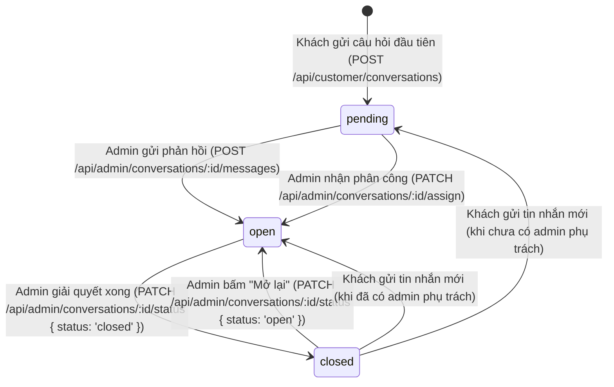

# TÀI LIỆU ĐẶC TẢ & HƯỚNG DẪN PHÁT TRIỂN TÍNH NĂNG CHAT CSKH DÀNH CHO FRONT-END
> **Căn cứ thiết kế:** Lấy luồng thiết kế Quản trị viên (`ADMIN`) làm gốc  
> **Dự án:** Phân tích & Thiết kế Website Bán Hàng Gia Dụng  
> **Áp dụng cho:** Đội ngũ phát triển Giao diện Khách hàng (`FRONT_END`) & Quản trị (`ADMIN`)  
> **Trạng thái Backend:** Đã xây dựng hoàn thiện toàn bộ Controller, Service, Validator và Routes  

---

## 1. TỔNG QUAN KIẾN TRÚC & TRIẾT LÝ LẤY ADMIN LÀM GỐC

Trong hệ thống hỗ trợ khách hàng của dự án, giao diện Quản trị viên (`ADMIN/src/pages/conversations`) đã định hình chuẩn mực về:
1. **Vòng đời hội thoại (State Lifecycle):** `pending` (Chờ tiếp nhận) ➔ `open` (Đang xử lý) ➔ `closed` (Đã đóng).
2. **Cơ chế phân công (Assignment):** Hỗ trợ trưởng ca chỉ định nhân viên qua dropdown hoặc nhân viên tự động nhận ca khi gửi tin phản hồi đầu tiên.
3. **Cơ chế quản lý tin nhắn & tin hệ thống (System Message):** Mỗi khi bàn giao ca hoặc đóng/mở hội thoại, hệ thống tự động sinh ra một tin nhắn loại `system` để đảm bảo tính minh bạch.
4. **Cơ chế chống gửi nhầm:** Khi ca hỗ trợ đã `closed`, khung soạn thảo bị khóa. Khách hàng gửi tin mới sẽ tự động tái kích hoạt (`re-open`) cuộc hội thoại.

Backend đã được xây dựng và kết nối đồng bộ theo đúng các nguyên tắc trên, cung cấp **2 bộ API song hành**:
- Bộ API Quản trị: `/api/admin/conversations` (yêu cầu token quyền `admin`).
- Bộ API Khách hàng: `/api/customer/conversations` (yêu cầu token khách hàng `customer`).

---

## 2. VÒNG ĐỜI HỘI THOẠI & QUY TẮC NGHIỆP VỤ (STATE MACHINE)



### Bảng quy tắc chuyển đổi trạng thái:

| Hành động | Tác nhân | Trạng thái ban đầu | Trạng thái đích | Hành vi phụ của Backend |
| :--- | :---: | :---: | :---: | :--- |
| **Gửi câu hỏi đầu tiên** | Khách hàng | `Chưa có` | `pending` | Tạo mới `Conversation`, lưu `Message`, tăng `adminUnreadCount = 1`. |
| **Gửi tin nhắn phản hồi** | Admin | `pending` hoặc `open` | `open` | Lưu tin nhắn, tự động gán `assignedAdminId = Admin gửi`, tăng `customerUnreadCount + 1`. |
| **Phân công / Bàn giao** | Admin | Bất kỳ | Giữ nguyên | Cập nhật `assignedAdminId`, tự động tạo 1 tin nhắn `system` ghi lại nhật ký bàn giao. |
| **Bấm Đóng hội thoại** | Admin | `open` | `closed` | Cập nhật `status = 'closed'`, tự động tạo 1 tin nhắn `system` thông báo đóng ca. |
| **Bấm Mở lại** | Admin | `closed` | `open` | Cập nhật `status = 'open'`, tự động tạo 1 tin nhắn `system` thông báo mở lại ca. |
| **Khách gửi tin vào ca đã đóng** | Khách hàng | `closed` | `open` (nếu đã có admin) / `pending` (nếu chưa gán) | Tự động **Re-open**, tăng `adminUnreadCount + 1`, tạo tin nhắn hệ thống ghi nhận khách đã nhắn lại. |
| **Mở xem cuộc hội thoại** | Cả hai | Bất kỳ | Giữ nguyên | Gọi API `PATCH .../read` để reset bộ đếm `unreadCount = 0` và cập nhật `isRead = true`. |

---

## 3. DANH SÁCH & ĐẶC TẢ API DÀNH CHO FRONT-END KHÁCH HÀNG (`FRONT_END`)

> **Base URL:** `/api/customer/conversations`  
> **Headers bắt buộc:** `Authorization: Bearer <Customer_JWT_Token>`  
> **Quy chuẩn Response:** `{ success: true, message: string, data: any, pagination?: any }`

### 3.1. Lấy cuộc hội thoại hiện tại (Current Active Conversation)
Dùng khi khách hàng tải trang hoặc mở Floating Widget để kiểm tra xem mình có cuộc hội thoại nào đang dở dang không.
- **Phương thức:** `GET /api/customer/conversations/current`
- **Response thành công (200):**
```json
{
  "success": true,
  "message": "Lấy hội thoại hiện tại thành công.",
  "data": {
    "id": "6739bc4e02a1d2f190e34a11",
    "subject": "Tư vấn bảo hành máy xay sinh tố",
    "status": "open",
    "assignedAdminName": "Nguyễn Văn Admin",
    "lastMessageAt": "2026-11-17T13:45:00.000Z",
    "lastMessagePreview": "Dạ shop đã nhận được yêu cầu bảo hành của anh/chị ạ.",
    "unreadCount": 1,
    "customerUnreadCount": 1,
    "createdAt": "2026-11-17T13:00:00.000Z",
    "updatedAt": "2026-11-17T13:45:00.000Z"
  }
}
```
*(Nếu khách chưa từng mở cuộc hội thoại nào, `data` sẽ trả về `null`).*

---

### 3.2. Khởi tạo cuộc hội thoại mới (Initiate Conversation)
Dùng khi khách hàng chưa có cuộc hội thoại nào hoặc muốn mở một yêu cầu hỗ trợ mới.
- **Phương thức:** `POST /api/customer/conversations`
- **Request Body (JSON):**
```json
{
  "subject": "Hỏi về phụ kiện nồi chiên không dầu",
  "firstMessage": "Shop cho mình hỏi nồi chiên 5L có kèm vỉ nướng chống dính không ạ?"
}
```
- **Response thành công (201):**
```json
{
  "success": true,
  "message": "Tạo cuộc hội thoại thành công.",
  "data": {
    "conversation": {
      "id": "6739bc4e02a1d2f190e34a11",
      "subject": "Hỏi về phụ kiện nồi chiên không dầu",
      "status": "pending",
      "assignedAdminName": "Bộ phận CSKH",
      "lastMessageAt": "2026-11-17T13:50:00.000Z",
      "lastMessagePreview": "Shop cho mình hỏi nồi chiên 5L có kèm vỉ nướng chống dính không ạ?",
      "unreadCount": 0,
      "customerUnreadCount": 0,
      "createdAt": "2026-11-17T13:50:00.000Z",
      "updatedAt": "2026-11-17T13:50:00.000Z"
    },
    "message": {
      "id": "6739bc4e02a1d2f190e34a12",
      "conversationId": "6739bc4e02a1d2f190e34a11",
      "senderId": "65b8214f9d01e123456789aa",
      "senderName": "Trần Thị Khách",
      "senderRole": "customer",
      "messageType": "text",
      "content": "Shop cho mình hỏi nồi chiên 5L có kèm vỉ nướng chống dính không ạ?",
      "attachments": null,
      "isRead": false,
      "readAt": null,
      "createdAt": "2026-11-17T13:50:00.000Z"
    }
  }
}
```

---

### 3.3. Lấy danh sách tin nhắn của cuộc hội thoại
Dùng để tải lịch sử trò chuyện khi mở khung chat.
- **Phương thức:** `GET /api/customer/conversations/:id/messages`
- **Response thành công (200):**
```json
{
  "success": true,
  "message": "Lấy danh sách tin nhắn thành công.",
  "data": [
    {
      "id": "6739bc4e02a1d2f190e34a12",
      "conversationId": "6739bc4e02a1d2f190e34a11",
      "senderId": "65b8214f9d01e123456789aa",
      "senderName": "Trần Thị Khách",
      "senderRole": "customer",
      "messageType": "text",
      "content": "Shop cho mình hỏi nồi chiên 5L có kèm vỉ nướng chống dính không ạ?",
      "attachments": null,
      "isRead": true,
      "readAt": "2026-11-17T13:52:00.000Z",
      "createdAt": "2026-11-17T13:50:00.000Z"
    },
    {
      "id": "6739bc4e02a1d2f190e34a15",
      "conversationId": "6739bc4e02a1d2f190e34a11",
      "senderId": "65b8214f9d01e123456789bb",
      "senderName": "Nhân viên CSKH",
      "senderRole": "admin",
      "messageType": "text",
      "content": "Chào bạn, sản phẩm đã đi kèm sẵn 1 vỉ nướng inox 304 cao cấp rồi bạn nhé!",
      "attachments": null,
      "isRead": false,
      "readAt": null,
      "createdAt": "2026-11-17T13:53:00.000Z"
    }
  ]
}
```

---

### 3.4. Khách hàng gửi tin nhắn (Send Message)
Dùng khi khách bấm nút "Gửi" trên khung chat.
- **Phương thức:** `POST /api/customer/conversations/:id/messages`
- **Request Body (JSON):**
```json
{
  "content": "Dạ em cảm ơn shop, thế shop có ship hỏa tốc trong 2h không ạ?",
  "messageType": "text",
  "attachments": []
}
```
*(Lưu ý: Nếu hội thoại trước đó đang ở trạng thái `closed`, gửi tin này sẽ tự động Re-open cuộc hội thoại).*
- **Response thành công (201):** Trả về đối tượng `message` vừa tạo.

---

### 3.5. Đánh dấu đã đọc tin nhắn (Mark Read)
Gọi API này ngay khi khách hàng click mở khung chat để reset số tin chưa đọc về 0.
- **Phương thức:** `PATCH /api/customer/conversations/:id/read`
- **Response thành công (200):**
```json
{
  "success": true,
  "message": "Đánh dấu đã đọc thành công."
}
```

---

### 3.6. Lấy danh sách lịch sử các cuộc hội thoại của khách
Dùng nếu giao diện phía khách có tab "Lịch sử yêu cầu hỗ trợ".
- **Phương thức:** `GET /api/customer/conversations?page=1&limit=10`
- **Response thành công (200):** Trả về mảng danh sách hội thoại kèm phân trang `{ total, page, limit, totalPages }`.

---

## 4. DANH SÁCH & ĐẶC TẢ API QUẢN TRỊ VIÊN (`ADMIN`)

> **Base URL:** `/api/admin/conversations`  
> **Headers bắt buộc:** `Authorization: Bearer <Admin_JWT_Token>`  
> **Khách hàng API:** Đã cấu hình tại `ADMIN/src/services/conversations/conversations.service.ts`

| Phương thức & Endpoint | Chức năng nghiệp vụ | Request / Query Params |
| :--- | :--- | :--- |
| `GET /api/admin/conversations/statistics` | Lấy 4 số liệu Dashboard: `{ total, open, pending, unread }` | Không có |
| `GET /api/admin/conversations/assignees` | Lấy danh sách nhân viên CSKH/Admin để đổ vào dropdown "Phân công cho" | Không có |
| `GET /api/admin/conversations` | Lấy danh sách hội thoại cho `ConversationList` | `keyword`, `status` (`all` \| `open` \| `pending` \| `closed`), `assignedAdminId`, `page`, `limit` |
| `GET /api/admin/conversations/:id` | Xem chi tiết 1 hội thoại | `id`: MongoID hội thoại |
| `GET /api/admin/conversations/:id/messages` | Lấy toàn bộ tin nhắn của hội thoại | `id`: MongoID hội thoại |
| `POST /api/admin/conversations/:id/messages` | Admin gửi tin nhắn trả lời | `{ content: string, messageType?: string, attachments?: string[] }` |
| `PATCH /api/admin/conversations/:id/assign` | Phân công hoặc bàn giao ca hỗ trợ | `{ assignedAdminId: string \| null }` (tự động tạo system message) |
| `PATCH /api/admin/conversations/:id/status` | Đóng hoặc Mở lại cuộc trò chuyện | `{ status: "open" \| "closed" \| "pending" }` (tự động tạo system message) |
| `PATCH /api/admin/conversations/:id/read` | Đánh dấu Admin đã đọc tin nhắn | Reset `adminUnreadCount = 0` |

---

## 5. HƯỚNG DẪN DÀNH CHO FRONT-END CLIENT (`FRONT_END`)

### 5.1. Thiết kế UI Khuyến nghị: Floating Chat Widget
Đội ngũ phát triển Frontend nên xây dựng một Floating Chat Widget ở góc dưới bên phải màn hình:
1. **Bong bóng chat thu nhỏ (Collapsed Floating Button):**
   - Nút tròn cố định `fixed bottom-6 right-6 z-50`.
   - Có badge đỏ hiển thị `customerUnreadCount` nếu > 0.
2. **Cửa sổ chat mở rộng (Expanded Chat Box):**
   - Kích thước chuẩn: rộng `380px`, cao `560px`, bo tròn `rounded-2xl`, có đổ bóng `shadow-2xl`.
   - **Header:** Hiển thị Logo Shop / Tên nhân viên phụ trách (`assignedAdminName`), trạng thái trực tuyến, nút thu nhỏ / đóng cửa sổ.
   - **Body (Khung tin nhắn):**
     - Tin khách: Bong bóng xanh/vàng bên phải.
     - Tin Admin: Bong bóng xám/trắng bên trái kèm avatar nhân viên.
     - Tin hệ thống (`system`): Căn giữa màn hình, chữ nhỏ màu ghi xám mờ (`text-xs text-gray-500 italic`).
   - **Footer (Soạn thảo tin nhắn):**
     - Ô input / textarea nhập tin nhắn và nút "Gửi".
     - Nếu cuộc hội thoại đang `closed`: Có thể hiển thị dòng ghi chú *"Cuộc hội thoại trước đó đã kết thúc. Nhắn tin bên dưới để bắt đầu hỗ trợ mới."* (hệ thống sẽ tự động Re-open).

### 5.2. Mã nguồn mẫu dịch vụ API Khách hàng (`customerChat.service.ts`)
Nhân viên Front-end có thể tạo tệp `FRONT_END/src/services/customerChat.service.ts` như sau:

```typescript
import { http } from "./http";

export const customerChatService = {
  // 1. Lấy hội thoại hiện tại
  getCurrentConversation() {
    return http.get("/customer/conversations/current");
  },

  // 2. Mở hội thoại mới
  createConversation(subject: string, firstMessage: string) {
    return http.post("/customer/conversations", { subject, firstMessage });
  },

  // 3. Lấy tin nhắn
  getMessages(conversationId: string) {
    return http.get(`/customer/conversations/${conversationId}/messages`);
  },

  // 4. Gửi tin nhắn
  sendMessage(conversationId: string, content: string) {
    return http.post(`/customer/conversations/${conversationId}/messages`, {
      content,
      messageType: "text",
    });
  },

  // 5. Đánh dấu đã đọc
  markRead(conversationId: string) {
    return http.patch(`/customer/conversations/${conversationId}/read`);
  },
};
```

---

## 6. KẾT LUẬN & ĐỐI SOÁT
- Logic Backend đã được xây dựng hoàn chỉnh, lấy toàn bộ luồng thiết kế của Admin làm gốc.
- Dữ liệu trả về hỗ trợ đồng thời cả `snake_case` (cho Admin UI hiện tại) và `camelCase` (cho chuẩn API hiện đại).
- Toàn bộ các kiểm tra biên (Validation, Transaction, System audit trail, Re-open khi đóng) đều đã sẵn sàng phục vụ sản xuất.
