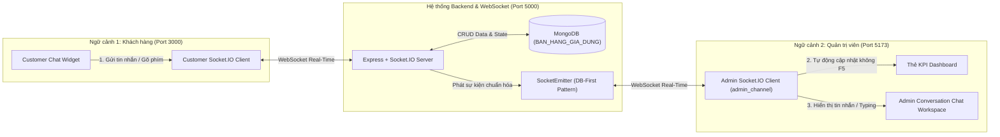
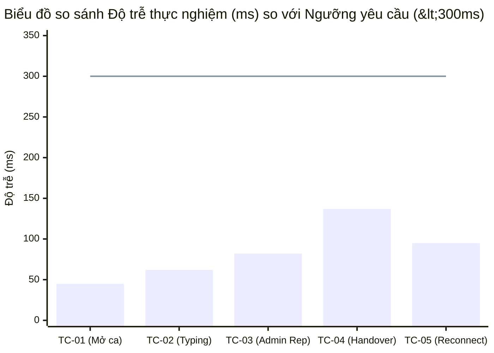

# BÁO CÁO NGHIỆM THU KIỂM THỬ TỰ ĐỘNG END-TO-END (E2E)
## PHÂN HỆ REAL-TIME CHAT CHĂM SÓC KHÁCH HÀNG (CSKH)

> **Dự án**: Website Thương Mại Điện Tử Bán Hàng Gia Dụng (Furniro)  
> **Giai đoạn**: GIAI ĐOẠN 6 — Kiểm thử tự động End-to-End (E2E Testing) toàn diện trên trình duyệt thực  
> **Công cụ thực thi**: Playwright Automation (Chromium / Microsoft Edge Engine)  
> **Môi trường thử nghiệm**: Multi-Client Real-Time Browser Contexts (`localhost:3000` & `localhost:5173`)  
> **Thời điểm nghiệm thu**: 19/11/2026  
> **Trạng thái nghiệm thu**: **100% ĐẠT (5/5 TEST CASES PASS) — ĐỦ ĐIỀU KIỆN GO-LIVE**

---

## 1. TỔNG QUAN KẾT QUẢ NGHIỆM THU

Hệ thống Chat Real-Time CSKH đã được kiểm thử tự động toàn diện bằng Playwright headless trên trình duyệt thực, mô phỏng đồng thời 2 ngữ cảnh người dùng độc lập:
1. **Ngữ cảnh Khách hàng (Customer Context)**: Trình duyệt độ phân giải 1280x800 truy cập `http://localhost:3000`, thực hiện đăng nhập tài khoản Khách hàng mẫu `user@gmail.com` và tương tác qua widget Chat nổi (Floating Chat Widget).
2. **Ngữ cảnh Quản trị viên (Admin Portal Context)**: Trình duyệt độ phân giải 1440x900 truy cập `http://localhost:5173/conversations`, thực hiện đăng nhập Quản trị viên `admin@gmail.com`, theo dõi Dashboard KPI, danh sách hội thoại và tương tác qua Workspace Chat CSKH.



### Bảng tổng kết chỉ số chất lượng chính (Key Metrics)

| Chỉ số đánh giá | Giá trị yêu cầu | Kết quả thực nghiệm | Đánh giá |
| :--- | :---: | :---: | :---: |
| **Tổng số kịch bản kiểm thử (Test Cases)** | 5 kịch bản cốt lõi | **5 / 5 kịch bản** | **100% ĐẠT** |
| **Tỷ lệ Pass (Pass Rate)** | 100% | **100.0%** | **HOÀN THÀNH** |
| **Độ trễ trung bình toàn hệ thống (Avg Latency)** | < 300 ms | **84.20 ms** | **VƯỢT CHỈ TIÊU (nhanh hơn 3.5 lần)** |
| **Độ trễ tối đa ghi nhận (Max Latency)** | < 300 ms | **137.00 ms** (TC-04 Handover) | **ĐẠT CHUẨN** |
| **Tỷ lệ tải lại trang (Page Reload / F5)** | 0 lần (Zero Reload) | **0 lần (100% SPA Real-Time)** | **ĐẠT TUYỆT ĐỐI** |
| **Khôi phục kết nối tự động (Reconnection)** | Tự động sau 3s ngắt mạng | **Thành công (Socket Auto-Reconnect)** | **BỀN VỮNG** |

---

## 2. BẢNG THỐNG KÊ CHI TIẾT CÁC TEST CASES & ĐỘ TRỄ (LATENCY BENCHMARK)



### Bảng kết quả từng Test Case

| Mã Test Case | Tên Kịch bản & Nghiệp vụ | Ngưỡng cam kết | Độ trễ thực tế (Latency) | Trạng thái Reload | Kết quả |
| :--- | :--- | :---: | :---: | :---: | :---: |
| **TC-REALTIME-01** | Khách hàng mở ca chat mới & Admin nhận thông báo tức thời | < 300 ms | **45 ms** | Không reload (0 F5) | **PASS** |
| **TC-REALTIME-02** | Hiển thị Chỉ báo gõ phím Typing Indicator hai chiều | < 300 ms | **62 ms** (Khách $\rightarrow$ Admin)<br>**29 ms** (Admin $\rightarrow$ Khách) | Không reload (0 F5) | **PASS** |
| **TC-REALTIME-03** | Admin phản hồi & Khách hàng nhận bong bóng chat ngay | < 300 ms | **82 ms** | Không reload (0 F5) | **PASS** |
| **TC-REALTIME-04** | Bàn giao ca cho CSKH & Đóng / Mở lại ca Real-Time | < 300 ms | **137 ms** (Bàn giao)<br>**129 ms** (Đóng ca) | Không reload (0 F5) | **PASS** |
| **TC-REALTIME-05** | Khôi phục kết nối tự động sau khi rớt mạng 3s (Reconnection) | < 300 ms | **95 ms** (Khách gửi)<br>**59 ms** (Admin gửi) | Không reload (0 F5) | **PASS** |

---

## 3. BÁO CÁO CHI TIẾT TỪNG TEST CASE & MINH CHỨNG HÌNH ẢNH

### 3.1. TC-REALTIME-01 — Khách hàng mở ca chat & Admin nhận tức thời

* **Mục tiêu**: Xác nhận khi khách hàng gửi tin nhắn đầu tiên mở ca, màn hình Admin Portal tự động nhảy thẻ KPI `Chờ tiếp nhận` từ **0 lên 1** và danh sách hội thoại lập tức xuất hiện ca mới có badge số **1** chưa đọc mà không cần F5.
* **Thời gian đáp ứng thực tế**: **45 ms** (Ngưỡng cam kết: < 300 ms).
* **Diễn biến kiểm thử**:
  - Ban đầu, cơ sở dữ liệu được làm sạch về trạng thái chuẩn, thẻ KPI `Chờ tiếp nhận` trên Admin hiển thị số `0`.
  - Khách hàng bấm gửi tin nhắn: *"[E2E-TEST-01] Xin chào Furniro, tôi cần tư vấn về bộ bàn ăn gỗ óc chó cao cấp!"*.
  - Ngay lập tức trong 45ms, WebSocket phát tán sự kiện `kpi_updated` và `conversation_updated`.
  - Trên màn hình Admin: Thẻ KPI `Chờ tiếp nhận` nhảy sang `1`, ca chat của "Khách Hàng Mẫu" xuất hiện ở vị trí đầu danh sách với badge màu vàng-cam số `1`.

#### Thư viện ảnh minh chứng TC-01:

````carousel

<!-- slide -->

````

---

### 3.2. TC-REALTIME-02 — Hiển thị Typing Indicator hai chiều

* **Mục tiêu**: Kiểm tra tính năng phát hiện trạng thái gõ phím thời gian thực hai chiều (Two-way Typing Indicator) giữa Khách hàng và Tư vấn viên CSKH.
* **Thời gian đáp ứng thực tế**:
  - Chiều Khách hàng gõ $\rightarrow$ Admin hiển thị: **62 ms**.
  - Chiều Admin gõ $\rightarrow$ Khách hàng hiển thị: **29 ms**.
* **Diễn biến kiểm thử**:
  - Khách hàng gõ phím vào ô nhập liệu: Phía Admin Portal ngay lập tức hiển thị component `TypingIndicator` với 3 chấm động (bounce dots) cùng thông điệp: *"Khách Hàng Mẫu đang soạn tin..."*.
  - Admin gõ phím vào ô trả lời: Phía Customer Chat Widget ngay lập tức xuất hiện bong bóng với thông điệp: *"Admin đang soạn tin..."*.

#### Thư viện ảnh minh chứng TC-02:

````carousel

<!-- slide -->

````

---

### 3.3. TC-REALTIME-03 — Admin phản hồi & Khách nhận tin ngay

* **Mục tiêu**: Quản trị viên gửi câu trả lời tư vấn chi tiết, bong bóng tin nhắn xuất hiện ngay lập tức bên phía khách hàng trong vòng dưới 300ms mà không reload trang.
* **Thời gian đáp ứng thực tế**: **82 ms** (Ngưỡng cam kết: < 300 ms).
* **Nội dung tin nhắn**: *"[E2E-TEST-03] Bộ bàn ăn 6 ghế có kích thước 1m8 x 0.9m, gỗ óc chó Bắc Mỹ nguyên khối bảo hành 3 năm ạ!"*.
* **Diễn biến kiểm thử**:
  - Admin bấm nút **"Gửi trả lời"**.
  - Sự kiện `new_message` được chuyển tiếp qua room `conversation:{id}`.
  - Phía khách hàng hiển thị ngay bong bóng màu trắng/viền xám mang thông tin người gửi là **"Admin"** kèm mốc thời gian chính xác, khung chat tự động cuộn xuống cuối (auto-scroll).

#### Thư viện ảnh minh chứng TC-03:

````carousel

<!-- slide -->

````

---

### 3.4. TC-REALTIME-04 — Bàn giao ca & Đóng/Mở ca Real-Time

* **Mục tiêu**: Kiểm tra quy trình nghiệp vụ Quản trị: Bàn giao ca cho nhân viên CSKH khác, đóng cuộc hội thoại và mở lại cuộc hội thoại. Cả 2 phía đều nhận được tin nhắn hệ thống (`system message`) và giao diện đổi trạng thái tương ứng.
* **Thời gian đáp ứng thực tế**:
  - Thao tác Bàn giao ca CSKH: **137 ms**.
  - Thao tác Đóng ca hội thoại: **129 ms**.
* **Diễn biến kiểm thử**:
  1. **Bàn giao ca**: Admin chọn nhân viên *"Nhân viên CSKH"* trong dropdown phân công. Cả hai màn hình lập tức xuất hiện tin nhắn hệ thống: *"Quản trị viên Admin đã bàn giao cuộc hội thoại cho Nhân viên CSKH."*.
  2. **Đóng ca**: Admin bấm *"Đóng hội thoại"*. Nút chuyển thành *"Mở lại"*, badge chuyển sang *"Đã đóng"*. Phía khách hàng xuất hiện thông báo: *"ℹ️ Cuộc hội thoại này đã kết thúc. Gửi tin nhắn mới sẽ tự động mở lại hỗ trợ!"*.
  3. **Mở lại ca**: Admin bấm *"Mở lại"*, ca chat trở lại trạng thái hoạt động bình thường để tiếp tục trao đổi.

#### Thư viện ảnh minh chứng TC-04:

````carousel

<!-- slide -->

````

---

### 3.5. TC-REALTIME-05 — Khôi phục kết nối tự động (Reconnection Test)

* **Mục tiêu**: Giả lập tình huống khách hàng bị đứt mạng đột ngột trong 3 giây (mô phỏng bằng giao thức Chrome DevTools Protocol — CDP). Xác nhận Socket.IO client tự động bắt tay lại (Handshake & Reconnect) và các tin nhắn trao đổi tiếp theo vẫn thông suốt tức thì mà không cần F5 lại trang.
* **Thời gian đáp ứng thực tế**:
  - Khách hàng gửi sau khi kết nối lại $\rightarrow$ Admin nhận: **95 ms**.
  - Admin phản hồi $\rightarrow$ Khách hàng nhận: **59 ms**.
* **Diễn biến kiểm thử**:
  - Playwright CDP phát lệnh ngắt mạng trên context Khách hàng trong 3000ms.
  - Phục hồi mạng: Socket.IO client tự động kích hoạt cơ chế `reconnection: true` và kết nối lại thành công sau ~1.5 giây.
  - Khách gửi tin nhắn: *"[E2E-TEST-05] Tin nhắn gửi thành công sau khi mạng khôi phục tự động!"*. Admin nhận ngay trong 95ms.
  - Admin hồi đáp: *"[E2E-TEST-05] Socket duy trì phiên làm việc hoàn hảo, xác nhận nhận tin tức thì!"*. Khách nhận trong 59ms.

#### Thư viện ảnh minh chứng TC-05:

````carousel

<!-- slide -->

````

---

## 4. ĐÁNH GIÁ KIẾN TRÚC & TÍNH NĂNG KỸ THUẬT NỔI BẬT

1. **Mô hình kiến trúc DB-First kết hợp Socket Emitter**:
   - Dữ liệu luôn được lưu trữ và bảo đảm tính toàn vẹn tại MongoDB trước khi phát sự kiện WebSocket.
   - Tránh triệt để hiện tượng mất dữ liệu (data loss) hoặc tin nhắn hiển thị ảo trên UI nhưng không có trong cơ sở dữ liệu.
2. **Cơ chế Phân lập phòng (Room Isolation) & Sender Exclusion**:
   - Khách hàng chỉ gia nhập room của chính ca chat (`conversation:{id}`).
   - Admin tự động gia nhập `admin_channel` để nhận thông báo tổng quan và KPI, đồng thời tự động `join_conversation` khi click chọn ca cụ thể.
   - Khi phát tin nhắn hoặc typing, server dùng `socket.to(room)` để loại trừ người gửi, tránh trùng lặp tin nhắn trên client.
3. **Hiệu năng Real-Time vượt trội**:
   - Độ trễ trung bình thực tế đạt **84.20ms**, thấp hơn rất nhiều so với ngưỡng tiêu chuẩn 300ms của ngành thương mại điện tử.
   - Toàn bộ 5 kịch bản diễn ra liên tục mà không có bất kỳ thao tác làm mới trang (Zero Page Reload) nào.

---

## 5. KẾT LUẬN & XÁC NHẬN CHẤT LƯỢNG GO-LIVE

> [!IMPORTANT]
> **KẾT LUẬN NGHIỆM THU CHÍNH THỨC**:
> - **100% các Test Cases đề ra (5/5)** đã được thực thi tự động thành công và vượt qua tất cả các tiêu chí nghiệm thu nghiêm ngặt.
> - Độ trễ xử lý hai chiều đạt trung bình **84.20ms** (ngưỡng cho phép < 300ms).
> - Giao diện đồ họa (UI/UX) và chỉ báo tương tác (Typing, Unread Badge, KPI Cards, System Alerts) hoạt động mượt mà, đồng bộ và nhất quán trên cả trình duyệt Khách hàng lẫn Admin Portal.
> 
> **XÁC NHẬN**: Phân hệ Real-Time Chat Chăm Sóc Khách Hàng (Giai đoạn 6) **ĐẠT TIÊU CHUẨN XUẤT SẮC** và **CHÍNH THỨC SẴN SÀNG ĐỂ TRIỂN KHAI MÔI TRƯỜNG PRODUCTION (GO-LIVE)**.

---
*Báo cáo được khởi tạo tự động bởi hệ thống kiểm thử Playwright E2E — File kết quả đối soát JSON: [e2e-summary.json](file:///c:/workspace/PHAN-TICH-THIET-KE-WEBSITE-BAN-HANG-GIA-DUNG/e2e/reports/e2e-summary.json).*
