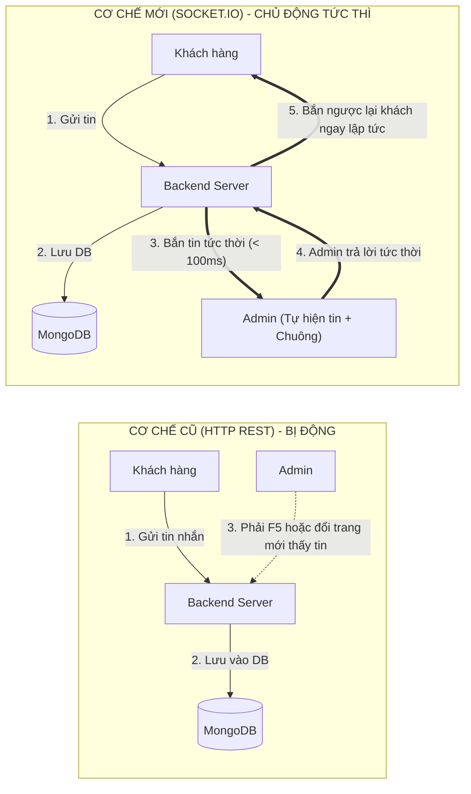
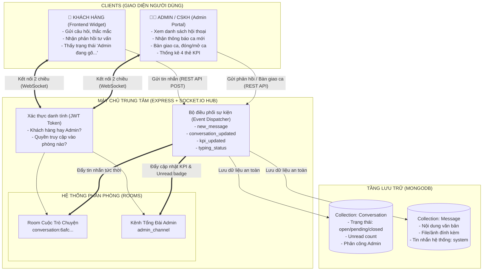

# KẾ HOẠCH TRIỂN KHAI REAL-TIME CHAT CSKH BẰNG SOCKET.IO
### Dự án: Website Thương Mại Điện Tử Bán Hàng Gia Dụng

---

> [!NOTE]
> **Tài liệu này được biên soạn dành cho:**
> - Lập trình viên trực tiếp triển khai tính năng.
> - Quản lý dự án, kiểm thử viên (QA/QC) hoặc bất kỳ thành viên nào trong đội ngũ muốn nắm rõ **bản chất cơ chế Real-time**, cách hệ thống vận hành và các bước đưa vào sử dụng thực tế.

---

## 1. DÀNH CHO NGƯỜI MỚI BẮT ĐẦU: SOCKET.IO LÀ GÌ VÀ VẬN HÀNH THẾ NÀO?

### 1.1. So sánh trực quan: Gửi thư bưu điện (HTTP) vs. Nói chuyện qua bộ đàm (Socket)

Hiện tại, hệ thống website của chúng ta đang hoạt động theo cơ chế **HTTP truyền thống**:
- **Cơ chế HTTP (Hiện tại):** Giống như việc bạn **gửi thư bưu điện**. 
  - Khách gửi một bức thư (gửi tin nhắn) tới máy chủ.
  - Máy chủ nhận thư và lưu vào ngăn kéo (MongoDB).
  - Nhưng Admin ngồi ở phòng bên cạnh **sẽ không hề biết có thư mới** cho đến khi Admin chủ động đứng dậy đi ra mở hòm thư kiểm tra (bấm F5 hoặc chuyển trang).

- **Cơ chế Socket.IO (Sắp triển khai):** Giống như hai bên cùng bật **bộ đàm 2 chiều hoặc gọi điện thoại trực tiếp**.
  - Ngay khi Khách hàng cất lời (gửi tin nhắn), âm thanh lập tức phát ra từ bộ đàm của Admin **ngay trong 0.1 giây**.
  - Admin không cần phải bấm nút hay làm mới màn hình; tin nhắn tự động xuất hiện trên màn hình cùng tiếng "ting" thông báo.



---

### 1.2. Khái niệm cốt lõi cần nhớ: "Phòng họp kín" (Rooms)

Trong một siêu thị trực tuyến, có thể có 50 khách hàng cùng nhắn tin hỏi mua hàng một lúc. Làm sao để tin nhắn của Khách A không bị nhảy sang màn hình của Khách B?

Socket.IO giải quyết việc này bằng khái niệm **Room (Phòng)**:

1. **Phòng riêng từng cuộc hội thoại (`conversation:{id}`):**
   - Mỗi khi Khách A mở khung chat mã số `#101`, hệ thống sẽ đưa Khách A và nhân viên chăm sóc ca `#101` vào phòng riêng mang tên `conversation:101`.
   - Bất cứ ai nói trong phòng này, chỉ những người trong phòng mới nghe thấy.
2. **Kênh tổng đài chung của Admin (`admin_channel`):**
   - Tất cả tài khoản Quản trị viên và Nhân viên CSKH khi đăng nhập đều được vào một kênh chung gọi là `admin_channel`.
   - Khi có một khách hàng mới tinh gửi tin nhắn đầu tiên (ca `pending`), máy chủ sẽ phát loa thông báo vào `admin_channel`: *"Có khách hàng mới cần tư vấn!"* -> Tất cả các máy tính của nhân viên đều tự động nhảy số thông báo và cập nhật thẻ KPI.

---

## 2. SƠ ĐỒ TƯ DUY KIẾN TRÚC TOÀN HỆ THỐNG

Sơ đồ dưới đây mô tả luồng vận hành khép kín giữa giao diện Khách hàng, Máy chủ Backend, Cơ sở dữ liệu và Giao diện Quản trị:



---

## 3. THIẾT KẾ DANH SÁCH CÁC SỰ KIỆN (SOCKET EVENTS SCHEMA)

Hệ thống sẽ giao tiếp qua các "tên lệnh" (Events) chuẩn hóa như sau:

| Tên sự kiện (Event) | Bên gửi | Bên nhận | Dữ liệu kèm theo (Payload) | Ý nghĩa thực tế |
| :--- | :---: | :---: | :--- | :--- |
| `join_conversation` | Client | Server | `{ conversationId }` | Yêu cầu bước vào phòng trò chuyện cụ thể. |
| `leave_conversation` | Client | Server | `{ conversationId }` | Rời khỏi phòng trò chuyện khi đóng tab/chuyển ca. |
| `new_message` | Server | Cả 2 bên | `MessageObject` (id, content, sender, role, time) | Bắn tin nhắn mới lập tức lên màn hình chat mà không cần reload. |
| `conversation_updated` | Server | Admin | `{ id, lastMessagePreview, unreadCount, status }` | Cập nhật đoạn preview tin nhắn và số badge chưa đọc ở cột bên trái. |
| `kpi_updated` | Server | Admin | `{ total, open, pending, unread }` | Cập nhật tức thời 4 thẻ thống kê trên Dashboard Admin. |
| `typing_status` | Cả 2 | Đối phương | `{ conversationId, isTyping, userName }` | Hiển thị thông báo *"Khách hàng đang soạn tin..."* hoặc *"CSKH đang soạn tin..."*. |
| `conversation_status_changed` | Server | Cả 2 bên | `{ conversationId, status }` | Thông báo ca đã đóng hoặc mở lại (để tự khóa/mở khung gõ phím). |

---

## 4. KẾ HOẠCH THỰC THI CHI TIẾT (6 GIAI ĐOẠN)

### Giai đoạn 1: Nâng cấp Backend & Khởi tạo Socket.IO Server
- **Mục tiêu:** Cài đặt thư viện, gắn Socket.IO vào HTTP Server hiện tại và bảo mật xác thực.
- **Các bước thực hiện:**
  1. Cài đặt thư viện tại thư mục `BACK_END`:
     ```bash
     npm install socket.io
     ```
  2. Nâng cấp [BACK_END/server.ts](file:///C:/workspace/PHAN-TICH-THIET-KE-WEBSITE-BAN-HANG-GIA-DUNG/BACK_END/server.ts):
     - Dùng `http.createServer(app)` bọc ứng dụng Express.
     - Khởi tạo instance `Server(httpServer, { cors: ... })`.
  3. Tạo file quản lý kết nối socket: `BACK_END/src/socket/index.ts`:
     - Tích hợp Middleware kiểm tra Token JWT từ `socket.handshake.auth.token` (sử dụng hàm verify sẵn có trong `src/utils/jwt.ts`).
     - Tự động nhận diện tài khoản: Nếu là `role: "admin"` thì tự động `socket.join("admin_channel")`.

---

### Giai đoạn 2: Tích hợp Socket vào tầng Nghiệp vụ Backend (Services)
- **Mục tiêu:** Tận dụng 100% logic API sẵn có; chỉ thêm bước bắn tín hiệu sau khi lưu database thành công.
- **Các bước thực hiện:**
  1. Tạo hàm tiện ích phát sự kiện toàn cục: `getIO()` hoặc `emitSocketEvent()`.
  2. Trong [customer.conversation.service.ts](file:///C:/workspace/PHAN-TICH-THIET-KE-WEBSITE-BAN-HANG-GIA-DUNG/BACK_END/src/services/customer/customer.conversation.service.ts):
     - Khi khách gửi tin nhắn (`sendCustomerMessageService`):
       - Lưu Message và Conversation vào MongoDB.
       - Phát event `new_message` tới `conversation:${conversationId}`.
       - Phát event `conversation_updated` và `kpi_updated` tới `admin_channel` để Admin nhận được ngay.
  3. Trong [admin.conversation.service.ts](file:///C:/workspace/PHAN-TICH-THIET-KE-WEBSITE-BAN-HANG-GIA-DUNG/BACK_END/src/services/admin/admin.conversation.service.ts):
     - Khi Admin gửi phản hồi: Phát `new_message` tới khách.
     - Khi Admin bàn giao ca hoặc Đóng/Mở ca: Phát `new_message` (tin nhắn hệ thống) và `conversation_status_changed` tới cả 2 phía.

---

### Giai đoạn 3: Tích hợp Phía Quản trị (`ADMIN`)
- **Mục tiêu:** Màn hình Admin nhận tin tức thời, tự nhảy số thống kê, không cần F5.
- **Các bước thực hiện:**
  1. Cài đặt thư viện tại thư mục `ADMIN`:
     ```bash
     npm install socket.io-client
     ```
  2. Xây dựng dịch vụ kết nối: `ADMIN/src/services/socket/socketClient.ts`:
     - Kết nối tới URL Backend cùng với `authToken.get()`.
     - Tự động kết nối lại khi rớt mạng (`reconnection: true`).
  3. Cập nhật [ConversationsPage.tsx](file:///C:/workspace/PHAN-TICH-THIET-KE-WEBSITE-BAN-HANG-GIA-DUNG/ADMIN/src/pages/conversations/ConversationsPage.tsx):
     - Lắng nghe event `new_message`: Thêm tin nhắn mới vào danh sách `messages` hiện tại nếu đang mở đúng ca chat đó.
     - Lắng nghe event `conversation_updated`: Đưa ca chat vừa có tin nhắn mới lên đầu danh sách và tăng badge chưa đọc.
     - Lắng nghe event `kpi_updated`: Cập nhật trực tiếp số liệu của 4 thẻ KPI.

---

### Giai đoạn 4: Tích hợp Phía Khách Hàng (`FRONT_END`)
- **Mục tiêu:** Chat Widget của khách hàng mượt mà, gửi nhận tin nhắn tức thì như Messenger / Zalo.
- **Các bước thực hiện:**
  1. Cài đặt `socket.io-client` trong `FRONT_END`.
  2. Khi khách hàng bấm mở cửa sổ chat hỗ trợ:
     - Gửi lệnh `join_conversation` với mã `conversationId` của khách.
     - Lắng nghe `new_message`: Nhận câu trả lời của tư vấn viên lập tức.
     - Lắng nghe `conversation_status_changed`: Cập nhật trạng thái hiển thị của ca tư vấn.

---

### Giai đoạn 5: Nâng Cao Trải Nghiệm Người Dùng (UX)
- **Mục tiêu:** Tăng tính trực quan và chuyên nghiệp cho hệ thống thương mại điện tử.
- **Các bước thực hiện:**
  1. **Typing Indicator (Đang nhập văn bản...):**
     - Khi người dùng gõ phím vào ô nhập tin nhắn -> Bắn event `typing_start`.
     - Dùng cơ chế `debounce 1.5s` (ngừng gõ sau 1.5s) -> Bắn event `typing_stop`.
     - Màn hình bên kia hiển thị 3 dấu chấm nhấp nháy chuyển động sinh động.
  2. **Âm thanh thông báo:**
     - Tích hợp một file âm thanh nhẹ nhàng (`notification.mp3`, dung lượng < 30KB).
     - Khi Admin nhận được tin nhắn mới từ khách hàng hoặc có ca `pending` mới -> Phát âm thanh chuông báo để nhắc nhở nhân viên trực máy.

---

### Giai đoạn 6: Kiểm Thử Tự Động, Xử Lý Ngoại Lệ & Dự Phòng (Fallback)
- **Mục tiêu:** Đảm bảo hệ thống hoạt động ổn định 24/7, không bao giờ mất tin nhắn.
- **Các cơ chế dự phòng bắt buộc:**
  1. **Lưu Database trước - Bắn Socket sau (DB-First Pattern):**
     - Mọi tin nhắn đều được ghi thành công vào MongoDB qua REST API trước khi phát tán qua Socket. Do đó, dù mạng gián đoạn đúng lúc bắn socket thì tin nhắn vẫn không bao giờ bị mất.
  2. **Tự động Fallback sang HTTP Polling:**
     - Trong trường hợp mạng nội bộ của khách hàng hoặc mạng công ty chặn kết nối WebSocket, Socket.IO sẽ tự động chuyển sang cơ chế HTTP Long-polling để duy trì nhắn tin bình thường.
  3. **Kiểm thử tự động:**
     - Mở 2 cửa sổ trình duyệt song song (1 bên Khách hàng, 1 bên Admin).
     - Gõ tin nhắn từ Khách -> Kiểm chứng trong vòng dưới 200ms tin nhắn xuất hiện bên Admin mà không tải lại trang.

---

## 5. BẢNG TIẾN ĐỘ & ƯỚC TÍNH NỖ LỰC (EFFORT ESTIMATION)

| Giai đoạn | Nội dung công việc | Thời gian dự kiến | Người thực hiện |
| :---: | :--- | :---: | :---: |
| **Giai đoạn 1** | Cài đặt & cấu hình Socket Server + JWT Auth Handshake | 1.5 giờ | Backend Dev |
| **Giai đoạn 2** | Tích hợp Socket Event Dispatcher vào các Services Backend | 1.5 giờ | Backend Dev |
| **Giai đoạn 3** | Tích hợp Socket Client vào Admin UI (Tin nhắn, KPI, Badge) | 2.0 giờ | Frontend/Admin Dev |
| **Giai đoạn 4** | Tích hợp Socket Client vào Khách hàng (Customer Chat Widget) | 1.5 giờ | Frontend Dev |
| **Giai đoạn 5** | Thêm Typing Indicator & Âm thanh thông báo | 1.0 giờ | Fullstack Dev |
| **Giai đoạn 6** | Kiểm thử kết nối, xử lý reconnect & nghiệm thu | 1.5 giờ | QA / Tester |
| **TỔNG CỘNG** | **Toàn bộ hệ thống Chat Real-Time hoàn chỉnh** | **~ 9.0 giờ** | *(Khoảng 1 - 1.5 ngày làm việc)* |

---

## 6. CHECKLIST NGHIỆM THU TÍNH NĂNG (ACCEPTANCE CRITERIA)

- [ ] **Kết nối an toàn:** Socket chỉ kết nối thành công khi có Token JWT hợp lệ.
- [ ] **Đúng phòng, đúng người:** Khách hàng A không nhìn thấy tin nhắn của Khách hàng B; Admin xem ca nào thì nhận tin đúng ca đó.
- [ ] **Tốc độ phản hồi:** Tin nhắn gửi đi hiển thị ở màn hình bên kia trong thời gian **dưới 200 mili-giây**.
- [ ] **Tự động cập nhật KPI:** Khi khách mở ca mới, thẻ *Chờ tiếp nhận* và *Tin chưa đọc* trên Admin tự tăng số tức thì.
- [ ] **Hiển thị đang gõ:** Thấy thông báo *"Đang soạn tin..."* khi phía bên kia nhập văn bản.
- [ ] **Khôi phục kết nối:** Khi ngắt mạng 5 giây rồi bật lại, Socket tự kết nối lại mà không yêu cầu người dùng F5.
- [ ] **Bền vững dữ liệu:** Reload lại trang bất kỳ lúc nào, toàn bộ lịch sử trò chuyện vẫn hiển thị đầy đủ, nguyên vẹn từ MongoDB.
