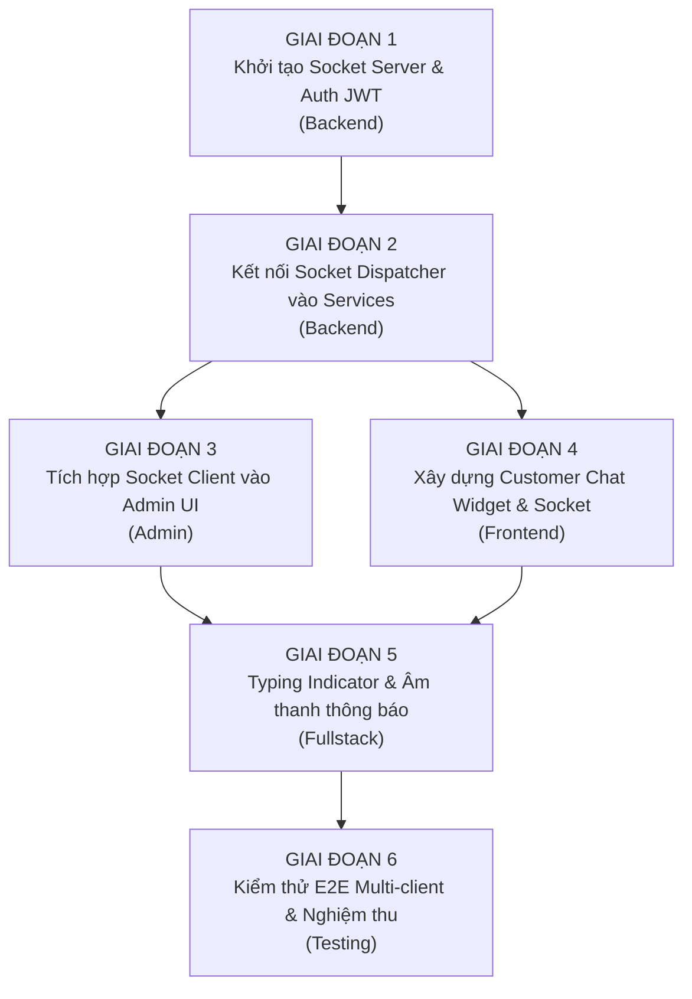

# BỘ PROMPT THỰC THI 6 GIAI ĐOẠN TRIỂN KHAI REAL-TIME CHAT CSKH (SOCKET.IO)
### Dự án: Website Thương Mại Điện Tử Bán Hàng Gia Dụng

---

> [!IMPORTANT]
> **ĐÁNH GIÁ TÍNH KHẢ THI TRONG MỘT PHIÊN LÀM VIỆC:**
> **KHÔNG NÊN** thực hiện toàn bộ 6 giai đoạn trong duy nhất 1 phiên làm việc.
> 
> **Lý do kỹ thuật:**
> 1. **Khối lượng mã nguồn trải rộng trên 3 phân hệ:** Cần can thiệp Backend Express (`BACK_END`), Quản trị Vite/React (`ADMIN`) và Giao diện cửa hàng (`FRONT_END` - hiện chưa có Chat Widget khách hàng).
> 2. **Kiểm soát chất lượng (Defensive Engineering):** Mỗi giai đoạn đều cần biên dịch, chạy unit/integration test, kiểm chứng kết nối WebSocket độc lập trước khi tích hợp tầng tiếp theo. Nếu làm dồn dập, khi gặp lỗi mất gói tin hoặc kẹt room sẽ rất khó định vị nguyên nhân.
> 3. **Tránh bão hòa bộ nhớ ngữ cảnh (Context Saturation):** Chia nhỏ theo từng giai đoạn giúp AI tập trung 100% năng lực vào từng bài toán cụ thể, đảm bảo code chuẩn, sạch và không gây xung đột logic hiện có.

---

## HƯỚNG DẪN SỬ DỤNG
- Mỗi giai đoạn dưới đây là một **Prompt độc lập, khép kín (Self-contained)**.
- Khi mở một phiên chat mới, bạn chỉ cần copy nguyên văn nội dung của Prompt tương ứng và gửi cho AI. AI sẽ tự động đọc hiểu toàn bộ cấu trúc dự án và thực thi chính xác phạm vi của giai đoạn đó.

---



---

## PROMPT GIAI ĐOẠN 1: KHỞI TẠO SOCKET.IO SERVER & XÁC THỰC JWT TẠI BACKEND

```markdown
<USER_REQUEST>
Thực hiện GIAI ĐOẠN 1 trong kế hoạch triển khai Real-Time Chat CSKH bằng Socket.IO cho hệ thống Backend (`BACK_END`): Khởi tạo Socket.IO Server và Middleware xác thực bảo mật JWT Handshake.

### 1. PHẠM VI & MỤC TIÊU
- Cài đặt thư viện `socket.io` vào `BACK_END`.
- Nâng cấp `BACK_END/server.ts` để gắn Socket.IO Server vào HTTP server hiện có mà không làm ảnh hưởng các REST API đang chạy.
- Xây dựng module quản lý Socket tập trung tại `BACK_END/src/socket/`.
- Xác thực bảo mật: Chỉ cho phép client kết nối thành công khi truyền Token JWT hợp lệ (`socket.handshake.auth.token`). Tự động phân loại role:
  - Tài khoản Admin tự động gia nhập phòng `admin_channel`.
  - Khách hàng kết nối vào namespace/socket riêng của họ.
- Viết kịch bản kiểm thử độc lập xác nhận Socket kết nối và từ chối token giả mạo thành công.

### 2. YÊU CẦU KỸ THUẬT CHI TIẾT
1. **Cài đặt thư viện:** Chạy `npm install socket.io` trong thư mục `BACK_END`.
2. **Cấu hình `BACK_END/src/socket/index.ts`:**
   - Khởi tạo Socket.IO với CORS hỗ trợ các origins cấu hình trong biến môi trường `CLIENT_URL` (cho phép `http://localhost:5173`, `http://localhost:3000`, credentials: true).
   - Middleware `io.use()`: Lấy token từ `socket.handshake.auth.token` hoặc headers Authorization. Tái sử dụng hàm `verifyToken` từ `BACK_END/src/utils/jwt.ts`.
   - Nếu token không hợp lệ hoặc hết hạn -> từ chối kết nối với lỗi `"Authentication error: Invalid or expired token"`.
   - Lưu thông tin user đã giải mã (`userId`, `role`) vào `socket.data.user`.
   - Lắng nghe sự kiện `connection`:
     - Nếu `socket.data.user.role === 'admin'`: Cho socket gia nhập `socket.join("admin_channel")`.
     - Lắng nghe `join_conversation`: Kiểm tra quyền sở hữu ca chat (Khách chỉ vào ca của mình, Admin vào được mọi ca) và gọi `socket.join(`conversation:${conversationId}`)`.
     - Lắng nghe `leave_conversation`: Gọi `socket.leave(...)`.
3. **Cập nhật `BACK_END/server.ts`:**
   - Dùng `http.createServer(app)` bọc ứng dụng Express.
   - Gọi hàm khởi tạo socket và lắng nghe cổng `PORT` (mặc định 5001).
4. **Viết script kiểm thử tự động:** Tạo `BACK_END/scripts/test-socket-auth.ts`:
   - Kiểm thử 3 trường hợp:
     a) Kết nối không có token -> Bị từ chối (Authentication error).
     b) Kết nối với token giả/hết hạn -> Bị từ chối.
     c) Kết nối với token Admin thật -> Thành công và đã ở trong room `admin_channel`.

### 3. TIÊU CHUẨN HOÀN THÀNH (DEFINITION OF DONE)
- Chạy script `test-socket-auth.ts` đạt kết quả `PASS` 100%.
- Toàn bộ các API Express hiện tại vẫn hoạt động bình thường, không có lỗi runtime.
</USER_REQUEST>
```

---

## PROMPT GIAI ĐOẠN 2: TÍCH HỢP SOCKET DISPATCHER VÀO SERVICES BACKEND

```markdown
<USER_REQUEST>
Thực hiện GIAI ĐOẠN 2 trong kế hoạch triển khai Real-Time Chat CSKH bằng Socket.IO: Tích hợp Bộ phát sự kiện (Socket Event Dispatcher) vào tầng Service của Backend (`BACK_END`).

### 1. PHẠM VI & MỤC TIÊU
- Tạo module phát sự kiện toàn cục `BACK_END/src/socket/socketEmitter.ts` để các service dễ dàng phát sự kiện mà không bị lỗi phụ thuộc vòng (circular dependency).
- Tích hợp phát sự kiện Real-Time vào [customer.conversation.service.ts] và [admin.conversation.service.ts].
- Áp dụng triệt để nguyên tắc **DB-First Pattern**: Luôn lưu vào MongoDB thành công trước, sau đó mới phát sự kiện Socket.
- Viết test script kiểm thử tích hợp: Giả lập 1 socket khách hàng và 1 socket admin cùng nghe các sự kiện thời gian thực khi gọi REST API.

### 2. YÊU CẦU KỸ THUẬT CHI TIẾT
1. **Module `BACK_END/src/socket/socketEmitter.ts`:**
   - Cung cấp các hàm tiện ích:
     - `emitNewMessage(conversationId, message)`: Gửi tới room `conversation:${conversationId}`.
     - `emitConversationUpdated(conversation)`: Gửi tới room `admin_channel` và room ca chat.
     - `emitKpiUpdated(kpiStats)`: Gửi tới room `admin_channel`.
     - `emitConversationStatusChanged(conversationId, status)`: Gửi tới room `conversation:${conversationId}`.
2. **Tích hợp vào `customer.conversation.service.ts`:**
   - Trong `createCustomerConversationService` và `sendCustomerMessageService`:
     - Sau khi `Message.create()` và `conversation.save()`:
     - Bắn `emitNewMessage(...)` tới room ca chat.
     - Bắn `emitConversationUpdated(...)` tới `admin_channel` để Admin thấy tin nhắn preview và badge unread tăng tức thì.
     - Tính toán lại thống kê và bắn `emitKpiUpdated(...)` tới `admin_channel`.
     - Nếu kích hoạt cơ chế Auto Re-open (hội thoại mở lại từ trạng thái closed): Bắn `emitConversationStatusChanged(...)`.
3. **Tích hợp vào `admin.conversation.service.ts`:**
   - Trong `sendAdminMessageService`: Bắn `emitNewMessage(...)` tới room ca chat (để khách hàng nhận được ngay).
   - Trong `assignAdminService`: Bắn `emitNewMessage(...)` (tin nhắn hệ thống bàn giao) và `emitConversationUpdated(...)`.
   - Trong `updateConversationStatusService`: Bắn `emitNewMessage(...)` (tin nhắn hệ thống đóng/mở ca), `emitConversationStatusChanged(...)` và `emitKpiUpdated(...)`.
4. **Viết script kiểm thử tích hợp:** Tạo `BACK_END/scripts/test-socket-events.ts`:
   - Kết nối 1 socket Client đóng vai Admin và 1 socket Client đóng vai Khách hàng.
   - Gửi tin nhắn qua API REST -> Xác nhận trong < 100ms cả 2 socket nhận đúng payload sự kiện `new_message` và `admin_channel` nhận đúng `kpi_updated`.

### 3. TIÊU CHUẨN HOÀN THÀNH (DEFINITION OF DONE)
- Script `test-socket-events.ts` đạt kết quả `PASS` 100%.
- Giữ nguyên vẹn toàn bộ 6/6 kịch bản kiểm thử API cũ tại `scripts/test-customer-conversation-flow.ts`.
</USER_REQUEST>
```

---

## PROMPT GIAI ĐOẠN 3: TÍCH HỢP SOCKET.IO CLIENT VÀO GIAO DIỆN QUẢN TRỊ (`ADMIN`)

```markdown
<USER_REQUEST>
Thực hiện GIAI ĐOẠN 3 trong kế hoạch triển khai Real-Time Chat CSKH: Tích hợp Socket.IO Client vào giao diện Quản trị (`ADMIN`) để cập nhật tin nhắn, danh sách hội thoại và 4 thẻ KPI theo thời gian thực mà không cần tải lại trang (F5).

### 1. PHẠM VI & MỤC TIÊU
- Cài đặt `socket.io-client` trong `ADMIN`.
- Xây dựng singleton kết nối `socketClient.ts` và React Hook `useAdminChatSocket`.
- Cập nhật [ConversationsPage.tsx] và các components con để tự động phản hồi ngay khi nhận sự kiện từ Socket Server.
- Đảm bảo an toàn: Nếu Socket rớt mạng hoặc chưa kết nối xong, ứng dụng vẫn hoạt động bình thường qua REST API (không crash).

### 2. YÊU CẦU KỸ THUẬT CHI TIẾT
1. **Cài đặt thư viện:** Chạy `npm install socket.io-client` trong thư mục `ADMIN`.
2. **Xây dựng `ADMIN/src/services/socket/socketClient.ts`:**
   - Kết nối tới URL Backend (`import.meta.env.VITE_API_BASE_URL` hoặc window.location.origin qua proxy).
   - Tự động đính kèm JWT token từ `authToken.get()`.
   - Cấu hình tự động kết nối lại (`reconnection: true`, `reconnectionDelay: 1000`).
3. **Xây dựng Hook `ADMIN/src/hooks/useAdminChatSocket.ts`:**
   - Quản lý trạng thái kết nối `isConnected`.
   - Đăng ký lắng nghe các sự kiện:
     - `new_message`: Nếu tin nhắn thuộc `selectedId` đang mở -> Thêm ngay vào state `messages` và tự scroll xuống cuối.
     - `conversation_updated`: Cập nhật lại item trong state `conversations` (cập nhật `last_message_preview`, thời gian và tăng `admin_unread_count` nếu không phải ca đang xem). Đẩy ca này lên đầu danh sách.
     - `kpi_updated`: Cập nhật trực tiếp state `kpiStats` (4 thẻ KPI).
     - `conversation_status_changed`: Cập nhật trạng thái `status` của ca tương ứng (đóng hoặc mở lại).
   - Tự động gọi `socket.emit("join_conversation", { conversationId: selectedId })` khi người dùng bấm chọn một ca khác, và rời ca cũ.
4. **Cập nhật `ConversationsPage.tsx`:**
   - Tích hợp hook `useAdminChatSocket`.
   - Hiển thị một chấm xanh nhỏ báo hiệu "Real-time đã kết nối" trên tiêu đề trang để nhân viên trực ca an tâm.

### 3. TIÊU CHUẨN HOÀN THÀNH (DEFINITION OF DONE)
- Chạy `npm run build` trên `ADMIN` không có lỗi TypeScript/linting.
- Mở trang Hội thoại trên Admin, dùng script gửi tin nhắn từ phía khách -> Tin nhắn tự động nhảy vào khung chat và 4 thẻ KPI tự cập nhật mà không cần bấm F5.
</USER_REQUEST>
```

---

## PROMPT GIAI ĐOẠN 4: XÂY DỰNG & TÍCH HỢP CHAT WIDGET KHÁCH HÀNG TRÊN `FRONT_END`

```markdown
<USER_REQUEST>
Thực hiện GIAI ĐOẠN 4 trong kế hoạch triển khai Real-Time Chat CSKH: Xây dựng Cửa sổ Chat hỗ trợ khách hàng (Floating Chat Widget) trên giao diện mua sắm (`FRONT_END`) và tích hợp kết nối Socket.IO hai chiều với Quản trị viên.

### 1. PHẠM VI & MỤC TIÊU
- Cài đặt `socket.io-client` trong `FRONT_END`.
- Xây dựng component `CustomerChatWidget`:
  - Nút tròn nổi (Floating Button) ở góc dưới cùng bên phải màn hình cửa hàng.
  - Khi bấm: Mở popup chat đẹp mắt, gọn gàng, đồng bộ phong cách thiết kế của cửa hàng gia dụng.
  - Tự động gọi API `/api/customer/conversations/current` để tải ca chat gần nhất (nếu có) hoặc cho phép tạo ca mới.
  - Gửi tin nhắn qua API `/api/customer/conversations/:id/messages`.
  - Kết nối Socket.IO: Gia nhập phòng `conversation:{id}` và nhận tin nhắn phản hồi của Admin ngay lập tức.
- Nhúng widget vào [StoreLayout.tsx] để xuất hiện xuyên suốt toàn bộ các trang của khách hàng.

### 2. YÊU CẦU KỸ THUẬT CHI TIẾT
1. **Cài đặt thư viện:** Chạy `npm install socket.io-client` trong thư mục `FRONT_END`.
2. **Xây dựng `CustomerChatWidget` tại `FRONT_END/src/components/chat/CustomerChatWidget.tsx`:**
   - **Giao diện:**
     - Nút tròn icon tin nhắn (MessageCircle) cố định góc phải màn hình (`fixed bottom-6 right-6 z-50`), có badge đỏ hiển thị số tin nhắn chưa đọc từ shop.
     - Khung chat kích thước ~380x520px trên Desktop (full-screen trên Mobile nhỏ):
       - Header: Tên shop, trạng thái "Tư vấn viên trực tuyến", nút đóng/thu nhỏ.
       - Body: Danh sách bong bóng chat (tin của khách căn phải màu vàng/thương hiệu, tin của Admin căn trái màu xám trắng, tin nhắn hệ thống căn giữa).
       - Footer: Khung nhập tin nhắn + nút gửi (Send icon).
   - **Xử lý trạng thái tài khoản:**
     - Nếu khách đã đăng nhập: Tự động dùng token của khách để kết nối socket và load lịch sử chat.
     - Nếu khách chưa đăng nhập: Hiển thị thông báo thân thiện *"Vui lòng đăng nhập để bắt đầu trò chuyện với nhân viên CSKH"*.
   - **Kết nối Socket:**
     - Khi mở ca chat: Bắn `socket.emit("join_conversation", { conversationId })`.
     - Lắng nghe `new_message`: Nhận tin nhắn trả lời của Admin ngay tức thì và tự scroll xuống cuối.
3. **Nhúng vào `StoreLayout.tsx`:** Đặt `<CustomerChatWidget />` ngay trước thẻ đóng layout để luôn hiển thị ở mọi trang.

### 3. TIÊU CHUẨN HOÀN THÀNH (DEFINITION OF DONE)
- Chạy `npm run build` trên `FRONT_END` không có lỗi.
- Mở trang chủ cửa hàng, đăng nhập tài khoản khách hàng, bấm vào widget chat và gửi tin nhắn -> Tin nhắn gửi thành công và nhận được phản hồi qua lại mượt mà.
</USER_REQUEST>
```

---

## PROMPT GIAI ĐOẠN 5: HOÀN THIỆN TRẢI NGHIỆM UX (TYPING INDICATOR & ÂM THANH)

```markdown
<USER_REQUEST>
Thực hiện GIAI ĐOẠN 5 trong kế hoạch triển khai Real-Time Chat CSKH: Bổ sung chỉ báo "Đang soạn tin nhắn..." (Typing Indicator) và Âm thanh chuông báo tin nhắn mới cho cả Khách hàng và Quản trị viên.

### 1. PHẠM VI & MỤC TIÊU
- Xử lý sự kiện `typing_start` và `typing_stop` tại Backend và phát tán tới đúng phòng cuộc hội thoại.
- Phía Frontend & Admin:
  - Khi người dùng gõ phím -> Gửi tín hiệu đang gõ kèm cơ chế `debounce 1500ms` (tự động ngừng khi dừng gõ sau 1.5 giây để tránh nghẽn socket).
  - Khung chat bên nhận hiển thị hiệu ứng hoạt họa 3 dấu chấm nhấp nháy: *"Khách hàng đang soạn tin..."* hoặc *"CSKH đang soạn tin..."*.
- Thêm âm thanh chuông báo nhẹ nhàng khi có tin nhắn mới hoặc ca mới cần tiếp nhận trên Admin.

### 2. YÊU CẦU KỸ THUẬT CHI TIẾT
1. **Backend (`BACK_END`):**
   - Lắng nghe sự kiện `typing_start`: Nhận `{ conversationId }`, phát tới `socket.to("conversation:" + conversationId).emit("user_typing", { userId, userName: socket.data.user.name, isTyping: true })`.
   - Lắng nghe sự kiện `typing_stop`: Phát `isTyping: false`.
2. **Client Admin & Frontend:**
   - Bắt sự kiện `onChange` hoặc `onKeyDown` trên ô `<textarea>`:
     - Gọi `socket.emit("typing_start", { conversationId })`.
     - Dùng `useRef` hoặc `setTimeout` để sau 1500ms không gõ thêm thì tự động gọi `socket.emit("typing_stop", { conversationId })`.
   - Thêm component nhỏ `TypingIndicator`: Hiển thị 3 chấm nhảy (bounce animation phong cách iOS / Messenger) ở cuối danh sách tin nhắn khi `isTyping === true`.
3. **Âm thanh thông báo (`ADMIN`):**
   - Tạo tiện ích phát âm thanh Web Audio API đơn giản (sử dụng Oscillator không cần file mp3 ngoài để đảm bảo 100% không phụ thuộc đường dẫn file) hoặc dùng âm thanh ngắn dạng Base64.
   - Khi nhận `new_message` từ khách hàng hoặc nhận ca `pending` mới -> Tự động phát âm thanh thông báo "Ting!" nhẹ nhàng. Có nút bật/tắt chuông trên Header trang Admin.

### 3. TIÊU CHUẨN HOÀN THÀNH (DEFINITION OF DONE)
- Khi một bên gõ phím, bên kia thấy ngay chỉ báo 3 dấu chấm chuyển động. Khi dừng gõ quá 1.5 giây, chỉ báo tự biến mất.
- Khi khách gửi tin nhắn, Admin nghe thấy tiếng chuông báo nhận tin.
</USER_REQUEST>
```

---

## PROMPT GIAI ĐOẠN 6: KIỂM THỬ END-TO-END TOÀN DIỆN & NGHIỆM THU (PLAYWRIGHT)

```markdown
<USER_REQUEST>
Thực hiện GIAI ĐOẠN 6: Kiểm thử tự động End-to-End (E2E Testing) toàn diện phân hệ Real-Time Chat CSKH bằng Playwright trên trình duyệt thực và xuất Báo cáo nghiệm thu hoàn chỉnh.

### 1. PHẠM VI & NGUYÊN TẮC
- Kiểm thử tự động kịch bản tương tác đa người dùng thời gian thực (Multi-client Real-Time): Mở đồng thời 2 ngữ cảnh trình duyệt (BrowserContexts):
  - Ngữ cảnh 1: Khách hàng mẫu đăng nhập tại `http://localhost:3000` (hoặc cổng Frontend).
  - Ngữ cảnh 2: Quản trị viên đăng nhập tại `http://localhost:5173/conversations`.
- Sử dụng Playwright headless (Chromium `msedge`) chụp ảnh màn hình minh chứng cho từng bước tương tác hai chiều.
- Đo đạc độ trễ nhận tin (Latency): Đảm bảo thời gian từ khi bên này bấm "Gửi" đến khi bên kia nhận được tin nhắn là **dưới 300ms** mà hoàn toàn KHÔNG CẦN reload trang.

### 2. CÁC TEST CASES CẦN THỰC THI & CHỤP ẢNH
1. **TC-REALTIME-01 — Khách hàng mở ca chat & Admin nhận tức thời:**
   - Khách hàng bấm gửi tin nhắn đầu tiên trên chat widget.
   - Xác nhận trên màn hình Admin: Thẻ KPI `Chờ tiếp nhận` tự động nhảy từ 0 lên 1, danh sách hội thoại tự động xuất hiện ca mới có badge số 1 chưa đọc trong vòng dưới 300ms. Chụp ảnh 2 màn hình.
2. **TC-REALTIME-02 — Hiển thị Typing Indicator hai chiều:**
   - Khách hàng gõ phím vào ô chat.
   - Xác nhận trên màn hình Admin: Xuất hiện chỉ báo *"Khách hàng đang soạn tin..."*. Chụp ảnh minh chứng.
3. **TC-REALTIME-03 — Admin phản hồi & Khách nhận tin ngay:**
   - Admin gõ câu trả lời và bấm "Gửi trả lời".
   - Xác nhận trên màn hình Khách hàng: Bong bóng chat của Admin xuất hiện ngay lập tức. Chụp ảnh minh chứng.
4. **TC-REALTIME-04 — Bàn giao ca & Đóng/Mở ca Real-Time:**
   - Admin bấm chọn bàn giao nhân viên CSKH hoặc Đóng ca.
   - Xác nhận cả 2 màn hình đều nhận tin nhắn hệ thống `system` và khung chat của khách cập nhật trạng thái tương ứng.
5. **TC-REALTIME-05 — Khôi phục kết nối tự động (Reconnection Test):**
   - Giả lập ngắt kết nối mạng 3 giây và bật lại.
   - Xác nhận Socket tự động kết nối lại và tin nhắn tiếp theo vẫn gửi nhận bình thường mà không cần F5 trang.

### 3. YÊU CẦU XUẤT BÁO CÁO NGHIỆM THU
- Tạo một Artifact Markdown báo cáo nghiệm thu hoàn chỉnh kèm thư viện ảnh minh chứng, bảng thống kê độ trễ (latency), tỷ lệ PASS/FAIL và xác nhận chất lượng Go-Live.
</USER_REQUEST>
```

---

## TỔNG KẾT BẢNG MÃ LỆNH & LỘ TRÌNH KHUYẾN NGHỊ

| Phiên làm việc | Prompt sử dụng | Nội dung trọng tâm | Kết quả bàn giao |
| :---: | :---: | :--- | :--- |
| **Phiên 1** | **Prompt Giai đoạn 1** | Cài Socket.IO Server & Auth JWT Handshake | Socket Server chạy ở port 5001, test auth PASS |
| **Phiên 2** | **Prompt Giai đoạn 2** | Gắn Socket Dispatcher vào Services Backend | Khi lưu DB thành công -> tự động bắn event |
| **Phiên 3** | **Prompt Giai đoạn 3** | Tích hợp Socket Client vào Admin UI | Admin nhận tin, nhảy badge, cập nhật KPI real-time |
| **Phiên 4** | **Prompt Giai đoạn 4** | Xây dựng Floating Chat Widget trên Frontend | Khách hàng có widget chat xịn sò, chat trực tiếp với Admin |
| **Phiên 5** | **Prompt Giai đoạn 5** | Typing indicator & Âm thanh thông báo | Hiệu ứng 3 chấm nhấp nháy, chuông báo khi có tin mới |
| **Phiên 6** | **Prompt Giai đoạn 6** | E2E Testing đa màn hình bằng Playwright | Báo cáo nghiệm thu hoàn thiện 100%, sẵn sàng bàn giao |
